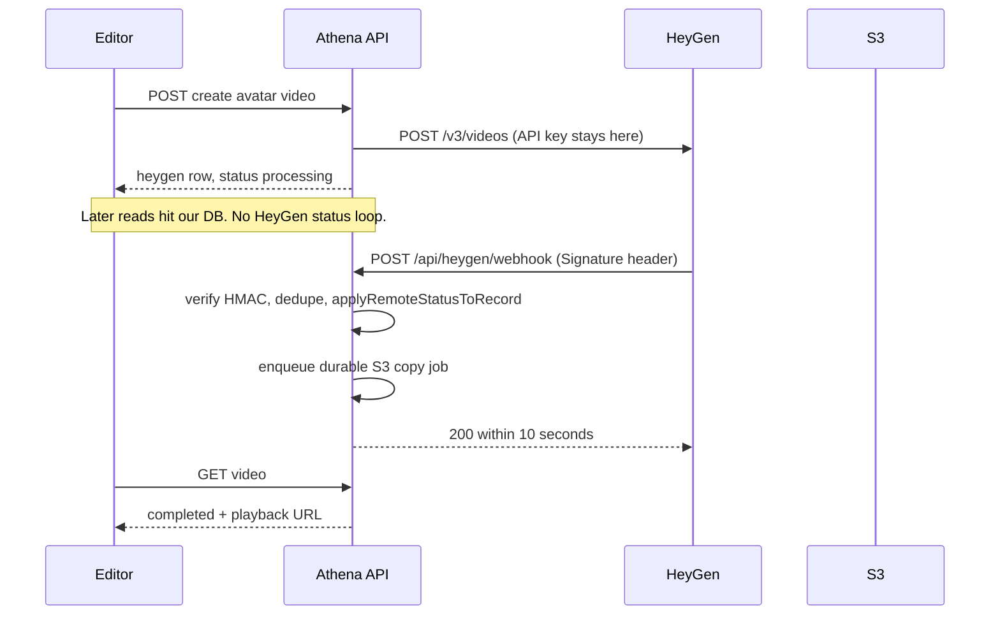
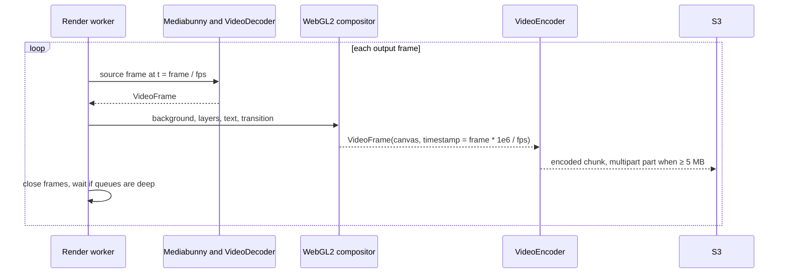
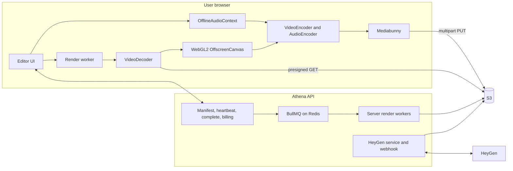

# Client-side video rendering — recommendations

**Status:** Recommendation, revised 3 November 2026 after review. Not an HTTP contract.
**Audience:** Backend and editor engineers deciding how Athena VI exports video.

Do the webhook and queue work now. Run the renderer spike and the alpha/audio spikes next. Commit to a full client pipeline only if those spikes pass the go/no-go bar in section 12. If they fail, the polling loop and the one-at-a-time render queue are still gone, which is what users feel today.

HeyGen keeps generating avatar footage. This backend keeps the API key, job records, S3 copies, credits, and a server render fallback. The browser composites and encodes the final video when the device can do it.

| Need | Doc |
|------|-----|
| Current render HTTP API | [`api/WORKSPACE_API.md`](api/WORKSPACE_API.md) |
| HeyGen project videos | [`api/HEYGEN_PROJECT_VIDEOS_API.md`](api/HEYGEN_PROJECT_VIDEOS_API.md) |
| Editor payload | [`PROJECT_EDITOR_INTEGRATION.md`](PROJECT_EDITOR_INTEGRATION.md) |
| HeyGen webhooks (official) | [Webhooks](https://developers.heygen.com/docs/webhooks), [event catalog](https://developers.heygen.com/docs/webhook-events) |

---

## 1. Recommendation

Use a **hybrid** renderer. Each export runs entirely in the browser or entirely on the server. Do not split one export across both.

| Party | Responsibility |
|-------|----------------|
| HeyGen | Avatar generation, lip sync, voice, the source MP4 or transparent WebM |
| This backend | Authentication, HeyGen calls, webhooks, S3 copy, presigned URLs, storage quota, credits, notifications, server render fallback |
| Browser | Download authorized S3 files, composite the timeline, mix audio, encode once, multipart-upload the MP4 |

**Browser stack, only if the renderer spike says Remotion's client renderer is not enough:** [WebCodecs](https://developer.mozilla.org/en-US/docs/Web/API/WebCodecs_API) + [Mediabunny](https://mediabunny.dev) + WebGL2 (Canvas 2D is enough for simple scenes) on [`OffscreenCanvas`](https://developer.mozilla.org/en-US/docs/Web/API/OffscreenCanvas) inside a Web Worker + chunked `OfflineAudioContext` + OPFS + S3 multipart upload. WebGPU is an optional later fast path.

Do not build the export on `MediaRecorder`. It records in real time and drops frames under load. Do not use ffmpeg.wasm for the video. The only allowed wasm use is encoding the already-mixed audio to AAC when the browser has no AAC encoder and product decides Linux Chrome must still export locally.

**Export:** H.264 High (`avc1.640028` at 1080p30; `avc1.64002A` when the project is 1080p60), about 10 Mbps, keyframe every 2 seconds, AAC-LC 192 kbps, 48 kHz stereo. Do not ship Opus-in-MP4 until it has been played in every app in the open-decisions list. Encode the final video **once**. The server path today encodes twice: a scene-cache MP4, then a final MP4 (`renderCompositionToFile` in `src/modules/render/render.service.js`).

**Renderer decision, before any client-render build**

Spend 1–2 weeks rendering three real projects through [Remotion's client-side renderer](https://www.remotion.dev/docs/client-side-rendering/): one simple, one with a transparent HeyGen avatar, one with the transitions in `src/modules/render/remotion/transitions`. Compare frames with the current server render, measure speed, and read the [Remotion license](https://www.remotion.dev/docs/license) for client renders.

- **If Remotion covers fidelity, speed, and license:** use it in the browser and keep Remotion on the server. Shared composition code removes most drift. It does not remove all of it: fonts, GPU, codec, and browser version can still differ, so golden-frame comparison stays.
- **If it does not:** build the WebCodecs compositor and run that same bundle in headless Chrome for fallback. Do not leave Remotion on the server as a second renderer long term.

**Alpha.** `VideoDecoder` does not return the VP8/VP9 alpha side channel, and Safari does not play alpha WebM. If the WebCodecs path is chosen, write a stacked-alpha H.264 at S3 ingest (color on top, greyscale alpha below) and recombine it in a shader. Test hair edges, the color matrix, and premultiplication on real avatars in the alpha spike, before the full compositor.

---

## 2. What the server does today

`src/modules/render/renderQueue.js` runs one render at a time inside this Node process. That is the queue users wait on, and the comment in that file says the queue is not shared across processes.

`processProjectRender` then:

1. Resolves every asset and HeyGen clip to a presigned S3 URL (`resolveProjectManifest`, TTL 3600 seconds).
2. Renders each scene to MP4 with Remotion (`codec: 'h264'`) and stores a scene cache keyed by `sceneHash`. That cache is only read by the next final encode in `render.service.js`. Nothing in the editor preview reads it.
3. Renders those scene MP4s again into `final.mp4`.
4. Uploads the final file, charges `FEATURE.REMOTION_EXPORT`, and notifies the inbox.

HeyGen status is separate. `pollLatestStatus` in `src/modules/video/services/heygen.service.js` calls `GET /v3/videos/:id` up to 24 times, 1.5 seconds apart, inside the HTTP request that loads the video. That is about 36 seconds. Generation takes minutes, so the loop rarely sees `completed`. The editor calls the API again, and the API calls HeyGen again. `getProjectHeygenVideo` enters this loop whenever `sync` is `status` (the default) or `full`.

`applyRemoteStatusToRecord` and `copyHeygenVideoToS3` already do the useful work. The webhook should call the status update, then enqueue `copyHeygenVideoToS3` on BullMQ. `queueHeygenVideoS3Upload` is in-process and is not durable enough.

---

## 3. First change: HeyGen webhooks

This does not depend on client rendering. HeyGen documents webhooks as the replacement for polling `GET /v3/videos/{video_id}` ([Webhooks](https://developers.heygen.com/docs/webhooks)).

Subscribe a public HTTPS URL to `avatar_video.success` and `avatar_video.fail`:

```bash
curl -X POST "https://api.heygen.com/v3/webhooks/endpoints" \
  -H "X-Api-Key: $HEYGEN_API_KEY" \
  -H "Content-Type: application/json" \
  -d '{
    "url": "https://<public-api-host>/api/heygen/webhook",
    "events": ["avatar_video.success", "avatar_video.fail"]
  }'
```

The create response includes `secret` once. Store it as `HEYGEN_WEBHOOK_SECRET`. List responses return `secret: null`. Rotating the secret invalidates the old one immediately.

Register a **separate endpoint and secret for dev, staging, and production**. A shared secret means a staging deploy can accept or forge production events, and rotating one environment breaks the others. Localhost is not a HeyGen target; local work uses a tunnel or the single status GET.



### Handler rules

Official delivery rules (same HeyGen page):

- Header `signature` is the hex HMAC-SHA256 of the **raw** body, using the endpoint secret. Compare in constant time. Re-serializing JSON breaks the signature.
- Respond `2xx` within **10 seconds**. Failures retry with backoff for up to 24 hours.
- The same event can arrive more than once. Persist a unique row on `(event_type, video_id)`, and on `event_id` when the delivered body includes one. Idempotent status transitions do the rest. Do **not** reject an event for being old. HeyGen retries for up to 24 hours, and the payload has no signed timestamp. A timestamp check would drop a real completion.
- `event_data.url` is a short-lived presigned download URL. Copy it promptly, or refresh it with `GET /v3/videos/{video_id}`.
- Success payload fields: `video_id`, `url`, `gif_download_url`, `video_page_url`, `video_share_page_url`, `folder_id`, `callback_id`. There is **no `duration`**. `chargeHeygenVideoIfNeeded` uses `remote.duration` when it is set, and already falls back to the script-length estimate.

Implementation constraints in this repo:

1. **No JWT on this route.** Trust is the signature. HeyGen cannot send our access token.
2. **`express.json()` in `src/app.js` runs before routes** and drops the raw bytes. Capture them with the parser `verify` hook for `POST /api/heygen/webhook`, and verify that buffer. Do not HMAC `JSON.stringify(req.body)`.
3. **Return 200 before the download.** `copyHeygenVideoToS3` downloads the whole file. Verify the signature, update the row, enqueue a **BullMQ** job, then respond. `queueHeygenVideoS3Upload` is an in-process `Set`. A restart mid-copy drops it until some later request happens to copy again. The job must survive that restart. The sweeper is the backstop, not the copy mechanism.
4. **Already `completed` with `s3Key`:** return 200 and do nothing.
5. **Unknown `video_id`:** log it and return 200 so HeyGen does not retry a video this API does not own. Our row is inserted minutes before HeyGen finishes, so a real race is unlikely. The sweeper below covers a missed event.
6. **Keep a single status GET**, not the 24-iteration loop, for three cases: the editor opens a row still `processing`; a render needs the file in S3 and the copy never finished (`assertHeygenVideoReadyInS3`); a sweeper for rows stuck in `processing` longer than a normal HeyGen generation. Localhost is not reachable by HeyGen, so local development needs that GET or a tunnel.
7. **Confirm one legacy v2 job.** Some looks still go through `createVideoV2` (`POST /v2/video/generate`). v3 `POST /v3/videos` is covered by `avatar_video.success`. Run one v2 job and confirm the same event before deleting the loop for that path.

The editor can keep asking this API whether the row is done. That read is the database. Pushing completion to the browser (SSE or inbox) is optional and separate.

Document `HEYGEN_WEBHOOK_SECRET` in [`api/ENVIRONMENT.md`](api/ENVIRONMENT.md) when the route ships, and update [`api/HEYGEN_PROJECT_VIDEOS_API.md`](api/HEYGEN_PROJECT_VIDEOS_API.md) so the editor stops tight-looping HeyGen through our status endpoint.

---

## 4. Fix the render queue in parallel

The fallback path needs a real queue whether or not the browser renders.

- Replace `renderQueue` with BullMQ on the Redis this process already connects to at startup. The HeyGen S3-copy job from section 3 uses the same queue infrastructure.
- Run Remotion in a separate worker process and scale that process on its own. Keep at least one worker warm. The hybrid cost table is variable render time only; an always-on fallback worker is extra and should be counted (section 10).
- **Final export is one full-timeline pass.** Stop encoding every scene and then encoding those files again.
- **Scene cache:** today it exists only to feed that second encode. Do not keep writing it for the final export. Add it back only if a later feature actually reads it, such as a scene preview. "Keep the cache for editor previews" is not true of the current code.

---

## 5. Browser technologies

Encoding support is not a pipeline. WebCodecs turns frames into compressed chunks and back. The app still owns demux, the timeline, compositing, audio mix, sync, mux, and upload.

| Technology | Role here | CPU / GPU | Support | Limit |
|------------|-----------|-----------|---------|-------|
| WebCodecs | Decode HeyGen and uploads; encode the export | Hardware video engine when the OS provides it, otherwise CPU | Chrome/Edge 94+, Safari 16.4+, Firefox 130+ desktop | No container format. No alpha from VP8/VP9. You must `close()` every `VideoFrame`. |
| WebGL2 | Transforms, stacked-alpha merge, transitions | GPU | Broad | Context loss. Texture size limits. |
| Canvas 2D | Text, shapes, simple scenes | Usually GPU-backed | Broad | Slower with many layers. |
| WebGPU | Optional effects fast path | GPU | Chrome 113+. Safari and Firefox coverage is newer and uneven. Check current MDN before requiring it. | Not the baseline. |
| OffscreenCanvas + Worker | Keep the editor thread free | Same as the canvas backend | Safari 17+ for WebGL on OffscreenCanvas | No DOM. |
| OfflineAudioContext | Mix voice-over, music, HeyGen audio | CPU, faster than real time | Broad | Not available inside a worker. Run it on the main thread. |
| Mediabunny | Read and write MP4/WebM on top of WebCodecs | Light CPU | Wherever WebCodecs works | Younger library than ffmpeg. |
| OPFS | Crash-safe encoded chunks | Disk, via the browser quota | Chromium, Firefox, Safari | Quota, not free disk space. |
| MediaRecorder | Do not use for export | Hardware encode | Broad | Real time only. Dropped frames. |
| ffmpeg.wasm | Audio-only fallback at most | CPU | Broad | No hardware encode. Memory ceiling. |
| SharedArrayBuffer | Avoid | — | Needs cross-origin isolation | `COOP`/`COEP` can break the Google sign-in popup. |

---

## 6. Detecting the device

The browser does not expose exact CPU, RAM, GPU model, or free disk. Classify from feature detection plus a short benchmark.

| Signal | API | What it actually is |
|--------|-----|---------------------|
| Logical cores | `navigator.hardwareConcurrency` | A hint. Some browsers cap it. |
| RAM | `navigator.deviceMemory` | Chromium only. Rounded and capped at 8 GB. |
| GPU name | `GPUAdapter.info`, `WEBGL_debug_renderer_info` | Often blank or generic. |
| Codec available | `VideoEncoder.isConfigSupported`, `VideoDecoder.isConfigSupported` | Supported, not "fast" and not "hardware". |
| Hardware hint | `navigator.mediaCapabilities.encodingInfo().powerEfficient` | Usually means a hardware encoder. |
| Storage quota | `navigator.storage.estimate()` | Browser quota, not free disk. |
| Live pressure | Compute Pressure API, Long Animation Frames | Chromium. Coarse. |
| Real speed | 3–5 second benchmark | The only number to tier on. |

These caps are **starting guesses**. Use this table everywhere until telemetry replaces it. Do not quote a second set (30 minutes, "15–20 minutes", "very long") elsewhere.

| Tier | Benchmark at 1080p30 | Local duration cap |
|------|----------------------|--------------------|
| High | 90 pipeline fps or better, and WebGL2 or WebGPU | 20 minutes |
| Mid | 30–89 fps | 10 minutes |
| Low | 8–29 fps, or software encode only | 2 minutes, or a 720p draft of a longer project |
| Unsupported | Under 8 fps, or a missing API or codec from the project gate below | Server |

Run the benchmark once per browser version and cache it for about 7 days: 90 synthetic 1080p frames through the real encoder config, a short bundled H.264 (and stacked-alpha) clip through the decoder, and one composite of a video texture plus images, text, and a transition. Estimate:

```
pipelineFps ≈ 1 / (1/encodeFps + 0.6 * avgVideoLayers / decodeFps + 1/compositeFps)
estSec      ≈ weightedFrames / pipelineFps + audioSeconds / audioRealtimeFactor + uploadBytes / uplink
```

Show that as a range. After about 5 seconds of real frames, switch the UI to a live ETA from the running frame time. Log estimate against actual duration and calibrate the weights. Do not change resolution in the middle of an export.

Worked sketch, same guesses: a 2-minute 1080p30 project (3,600 frames) with several HeyGen clips is the go/no-go sample in section 12. A recent laptop is hoped to finish the export in under 3 minutes. An old dual-core on software encode is the Low or Unsupported row and uses the server. Client rendering is not always faster than the server.

### Per project, not only per device

The benchmark describes the machine. Before each export, also probe **this** project. `VideoDecoder.isConfigSupported` answers codec configuration. It does not say the demuxer can open the file. Probe the container (Mediabunny or equivalent) and then `isConfigSupported` for every video and audio track, and for the chosen output config.

Send the job to the server up front when any of these fail:

- Codec, profile, or level the browser cannot decode (HEVC phone clips are the common case).
- Container the demuxer cannot read. MOV can fail even when the underlying codec is supported.
- Width, height, rotation metadata, or a pixel format the pipeline does not handle.
- HDR or a color space the compositor would clip.
- Variable frame rate the timestamp picker does not handle yet.
- Audio codec that cannot be decoded for the mix.
- Output config, including 1080p60, which needs H.264 High level 4.2 (`avc1.64002A`), not the 1080p30 level 4.0 config.
- No AAC encoder, unless the product has explicitly allowed the ffmpeg.wasm audio fallback for that browser.

### During the render

- All decode, draw, encode, and mux work stays in the worker. The main thread mixes audio and paints the UI.
- Cap frames in flight. A 1080p RGBA frame is about 8 MB. Call `VideoFrame.close()` as soon as the frame is used.
- Pause the editor preview while exporting. It competes for the same hardware decoders.
- If throughput stays under half the benchmark for about 30 seconds, or the tab fails twice, offer the server path.
- Background tabs can freeze or be discarded ([page lifecycle](https://developer.chrome.com/docs/web-platform/page-lifecycle-api)). A worker loop usually continues, and nothing guarantees it. Tell the user to keep the tab open.

---

## 7. Client render pipeline

Reuse `resolveProjectManifest`. It already normalizes scenes, swaps asset and HeyGen ids for presigned URLs, and computes `sceneHash`. A new route should return that manifest plus a render id. The worker turns it into a frame schedule. Share `buildSceneTimings` (`src/modules/render/remotion/transitions`) so client and server agree on transition overlap.



Audio is mixed on the main thread in **chunks of about 30 seconds**, then streamed to the encoder. One `OfflineAudioContext` for a long timeline holds the whole mix in RAM (stereo float32 is about 46 MB for 2 minutes, and it grows linearly). Each chunk needs a short look-ahead, on the order of the longest fade or crossfade, and that overlap is trimmed before encode. A hard cut at the chunk boundary clicks when a fade crosses it.

Lip sync holds because video timestamps and audio sample positions come from the timeline, not the wall clock. HeyGen output is often 25 fps while projects default to 30 (`DEFAULT_VIDEO_SETTINGS`). Pick source frames by timestamp so the avatar plays at the right speed. A few frames repeat. Audio stays on the clip start time.

**AAC.** Prefer the browser `AudioEncoder` (`mp4a.40.2`). It is commonly missing on Linux Chrome. Default for that browser is the server, which already encodes AAC. Use ffmpeg.wasm on the mixed PCM only if product explicitly wants those browsers to export locally. Do not put Opus in the MP4 until the playback list in section 15 has been checked.

Stream the MP4 (`fastStart: 'fragmented'` in Mediabunny) to S3 multipart upload. Parts are at least 5 MB except the last ([multipart overview](https://docs.aws.amazon.com/AmazonS3/latest/userguide/mpuoverview.html)). Fragmented MP4 must be played in the apps from section 15, not only QuickTime, VLC, and PowerPoint. If a target rejects it, remux to a fast-start MP4 with the `moov` atom at the front before calling the file done. The client never chooses the object key. The server issues `buildProjectRenderFinalKey` and presigned part URLs.

**Before issuing those URLs:**

- Run `assertOwnerCanFitAdditionalBytes` against the estimated file size.
- Reserve the estimated `REMOTION_EXPORT` credits for this `renderId`. Settle or release the reservation at `complete` or when the render is abandoned. The reservation needs an expiry so a closed tab does not hold credits forever. The existing charge idempotency key `project-render:${renderId}` stays the settle key. `complete` still checks the real object size and duration so a client cannot reserve a small file and upload a large one.
- Put an S3 lifecycle rule on the bucket to abort incomplete multipart uploads after 1–7 days.
- CORS for the editor origin allows `GET`, `HEAD`, and `PUT`, and exposes `Content-Range`, `Accept-Ranges`, and `ETag`. `PUT` is required for the upload. `ETag` is required to complete the multipart upload.

`POST .../renders/:id/complete` then checks the object, settles the credit reservation, marks the render completed, and sends the inbox notification. It rejects a client complete when the render attempt has been fenced.

**Upload fencing.** Falling back to the server aborts the client's multipart upload and marks that `uploadId` invalid. A late client `complete` must not succeed beside the server output. One render id has one winning attempt.

Refresh presigned GETs on long renders. Today's TTL is 3600 seconds.

Suggested `ProjectRender` fields when this ships: `renderMode` (`client` | `server` | `client_fallback`), `clientCapabilities`, `heartbeatAt`, `uploadId`, `creditReservationId`. A job flags a client render with no heartbeat for 10 minutes as stalled and offers server fallback.

### Where each export runs

| Situation | Where |
|-----------|--------|
| High or mid desktop, duration inside the tier cap in section 6, project gate passed | Browser |
| Low tier inside its 2-minute cap, or an accepted 720p draft | Browser, reduced settings |
| Low tier over the cap, mobile, or unsupported browser | Server |
| Over the tier duration cap, or any asset the project gate cannot decode | Server |
| Crash or closed tab | Resume from OPFS checkpoints, then server |
| Out of memory or storage quota | Server |

Joining browser-encoded scenes with server-encoded scenes without a second encode is unreliable. Different machines emit different H.264 parameter sets. Do not split a job.

Checkpoints: write about 10 seconds of encoded chunks to OPFS and the progress index to IndexedDB, and upload finished parts while encoding. On resume, restart from the last keyframe. If the new encoder session reports a different `decoderConfig.description`, start over or fall back to the server.

---

## 8. HeyGen footage in the browser

Generation does not move. The browser never calls `api.heygen.com` and never sees `X-Api-Key`. It uses the S3 copy, the same URLs Remotion fetches today. HeyGen CDN URLs expire (the webhook `url` is explicitly short-lived). `syncHeygenVideoToS3AndDb` is what makes client rendering possible.

| Footage | Treatment |
|---------|-----------|
| H.264 MP4 | Mediabunny + `VideoDecoder`. Hardware decode on typical desktops. |
| Alpha WebM | Do not decode in WebCodecs and hope for alpha. Use the stacked-alpha H.264 written at ingest. Compare hair and edge halos against the Remotion reference before building the rest of the compositor. |
| Audio | Extract, mix in 30-second chunks with fade overlap, encode AAC. |
| Quality | Compositing forces a re-encode. Do it once, at about 10 Mbps. That is one fewer generation loss than today's scene-cache-then-final path. Stream copy of an untouched full-frame avatar is not worth a special mux path. |

HeyGen rate limits and generation time are unchanged. Client rendering does not reduce HeyGen spend.

---

## 9. Architecture



---

## 10. Cost

These are planning estimates, not quotes. Check [EC2 on-demand](https://aws.amazon.com/ec2/pricing/on-demand/) and [S3](https://aws.amazon.com/s3/pricing/). Measure the real server time from `ProjectRender.startedAt` and `completedAt` before using them for capacity.

Assumptions used here: 4 exports per user per month, 3 minutes average, about 2 minutes of server CPU per minute of video. That CPU ratio is a guess for today's double encode on a 16-vCPU machine such as a `c7i.4xlarge` (about $0.71/hour in us-east-1 when this was written). Replace it with `ProjectRender.startedAt` and `completedAt` before buying capacity. Peak headroom is about 3× average. Internet egress is about $0.09/GB. A 3-minute file is about 180 MB. HeyGen cost is the same in every column and is excluded. Uploads into S3 are free. Downloads of the finished file exist in all three designs.

The hybrid column is **variable render time only**. It does not include a warm fallback worker. One always-on 16-vCPU worker is on the order of $500/month before it renders anything. Add that floor, or the cost of a scale-to-zero worker's cold start, on top of the hybrid numbers. At 1,000 users the floor can be larger than the variable savings.

| Monthly | Server only | Hybrid, about 80% of exports in the browser |
|---------|-------------|-----------------------------------------------|
| 1,000 users | On the order of $1k with peak headroom | On the order of $200 |
| 10,000 users | Several thousand dollars | About $2k |
| 100,000 users | Tens of thousands | About $20k |

A realistic offload is about 70–90% of **render** minutes on a desktop-heavy audience. What stays on the server: mobile, unsupported browsers, long videos, closed tabs, and the HeyGen S3 copy plus the stacked-alpha transcode. At 1,000 users the dollar change is modest. The earlier product win is no render queue and flat scaling. HeyGen remains the large variable cost.

GPU instances do not pay for themselves while Remotion's rasterization and x264 encode are CPU-bound. Skip them unless the server fallback adopts the same renderer with hardware encode.

---

## 11. Security

| Topic | What to do |
|-------|------------|
| HeyGen credentials | Stay in backend env. The webhook route is the only new public HeyGen surface, and it accepts only a valid `signature`. |
| Rendering code | It ships to the browser and can be read. Minify it. The valuable pieces are templates, assets, and the backend orchestration. |
| Billing | Reserve estimated credits when the upload is issued. Settle with `project-render:${renderId}` at `complete`, after the S3 object exists and its duration matches the manifest. Release the reservation if the render is abandoned or fenced to the server. |
| Watermarks | A client-side watermark can be removed. Keep watermarked tiers on the server if the mark must stick. |
| Asset URLs | Short-lived presigned URLs or CloudFront signed cookies, scoped to the workspace role. Same files the preview already streams. |
| Object keys | Server-generated only (`buildProjectRenderFinalKey`). |
| Cross-origin isolation | Do not turn on `SharedArrayBuffer` for this work. It can break Google OAuth popups. |

---

## 12. Build order

Ship phase 0 immediately. It does not depend on the renderer choice. Do not start the full compositor until the two spikes have a written go or no-go.

| Phase | Work | Done when |
|-------|------|-----------|
| 0. Webhooks and queue | Separate webhook endpoints and secrets for dev, staging, and prod. Raw-body HMAC. Idempotent status update. BullMQ job for the S3 copy. BullMQ render workers. One-pass final export. Stop writing the scene cache unless something reads it. Confirm a v2 job emits `avatar_video.success`. | The editor no longer triggers HeyGen status loops. A restart during the S3 copy still finishes the copy. Two exports run at once. |
| Spike A. Renderer | Three real projects through Remotion client rendering: simple, HeyGen alpha, transitions. Frame diff against the server render. License check. | A written choice: shared Remotion, or one WebCodecs bundle in the browser and in headless Chrome. |
| Spike B. Alpha and audio | If WebCodecs: stacked-alpha on a real avatar (edges, color matrix, premultiplication). 30-second audio chunks with a fade across the boundary. AAC on the target browsers. Fragmented MP4 in the playback apps from section 15. | Lip-sync error under one frame on a 2-minute project. No click at the chunk boundary. Edges accepted against the Remotion reference. |
| Go / no-go | Use the spike measurements, not the guesses in section 6. | On the beta hardware cohort, the median 2-minute 1080p30 export finishes in under 3 minutes, frames match the server reference closely enough for product, and A/V drift stays under one frame. |
| 1. Proof of concept | The renderer chosen above. Device benchmark plus the per-project gate. Credit reservation, multipart upload, fencing, and the server fallback button. Feature flag, internal users only. Golden frames and outcome logs (browser, GPU, tier, failure reason) from the first export, not from a later phase. | The go/no-go bar holds on internal machines. "Render on server" always works. |
| 2. Adaptive | Tiers, live ETA, OPFS checkpoints, stalled-render sweeper. Invite-only beta. | 95% of started client renders finish or fall back. Estimate within ±30% after 5 seconds. |
| 3. Production | Widen the flag. Cost dashboard including the warm fallback worker. | About 75% of eligible render minutes on clients. Client failure rate under 3%. Server render CPU down at least 60% against the measured baseline. |

Rollout stays opt-in. The flag is per user or per workspace. The editor always shows a one-click server render. A kill switch turns client export off without a deploy of the renderer.

---

## 13. Limits

- The user must keep the tab open. Sleep, a discarded background tab, or a crash stops a local render. Checkpoints let them resume or send it to the server. Local exports follow the duration caps in section 6 (20 / 10 / 2 minutes). Those caps are guesses until telemetry replaces them.
- Speed depends on the machine. Low-end and mobile devices use the server. A slow uplink dominates, because the file is on the order of 100–200 MB.
- AAC encoding is not available in every browser.
- Alpha WebM needs the ingest transcode.
- Output will differ from Remotion until both sides run the same renderer.
- HeyGen generation time does not change.

---

## 14. Answers

1. **Is client-side rendering practical?** Yes, as a hybrid, after the spikes pass. Initial local caps are 20 / 10 / 2 minutes by tier. The server path stays.
2. **Which technologies?** Decide in spike A. If Remotion's client renderer is enough, use Remotion in the browser and on the server. Otherwise WebCodecs, Mediabunny, WebGL2 on `OffscreenCanvas` in a worker, chunked `OfflineAudioContext`, OPFS, and S3 multipart upload, with that same bundle on the server.
3. **Can we use the user's CPU and GPU?** Yes. Compositing goes through WebGL or Remotion's browser renderer. Encode and decode go through the browser's hardware video engine when `powerEfficient` and the benchmark say so. The page cannot reserve cores or read exact specs.
4. **How do we classify hardware?** Feature-detect, then a 3–5 second benchmark, then the four tiers in section 6. Before each export, probe that project's containers and codecs. Keep watching throughput during the export.
5. **How do we preserve HeyGen quality?** Leave generation on HeyGen. Copy to S3 with a durable job. Pre-transcode alpha WebM only if the WebCodecs path is chosen, and accept the edges in spike B. Place audio and video on the same timeline. Re-encode the final video once at about 10 Mbps AAC.
6. **What stays on the backend?** Auth, all HeyGen calls, the webhook, the S3 copy job, quotas, credit reservation, notifications, and fallback rendering.
7. **Will server cost drop?** Render CPU can drop about 70–90% of eligible minutes. Subtract a warm fallback worker (on the order of $500/month for one 16-vCPU box). HeyGen spend is unchanged. At 1,000 users the worker floor can erase the variable savings.
8. **What will users feel?** Opt-in at first, with "Render on server" always visible. They keep the tab open. Weak devices and some browsers stay on the server. Uploads take time on slow connections.
9. **What is first?** Phase 0 (webhooks and the queue). Then the renderer spike and the alpha/audio spike. The proof of concept starts only after the go/no-go bar.
10. **What is the production architecture?** One renderer, two hosts, chosen by spike A. The browser renders and uploads by default for flagged users. The server fleet runs the same renderer for fallback. Each export runs entirely on one host.

---

## 15. Decisions still needed

Engineering can start phase 0 without these. The spikes and the proof of concept cannot finish without them.

| Decision | Why it blocks |
|----------|----------------|
| Public base URL for dev, staging, and production | Each needs its own HeyGen webhook endpoint and secret. |
| Apps that must play the exported MP4 | Fragmented MP4, AAC, and a future Opus trial are accepted or rejected against this list. QuickTime, VLC, and PowerPoint are not enough if users also upload to an LMS, WhatsApp, Instagram, or YouTube. |
| Linux desktop share, and whether those users may export locally | Missing AAC either sends them to the server or allows ffmpeg.wasm for the audio track only. |
| Watermark on free exports | If the mark must survive, those exports stay on the server. |
| How long a credit reservation may be held | Closed tabs have to release the hold. A number (for example 24 hours) is a product choice. |
| Who is in the first flag | Internal accounts, then the beta workspace list. |
| Acceptable visual difference versus today's Remotion output | The go/no-go line says "closely enough for product". Someone has to sign the frame comparison. |
