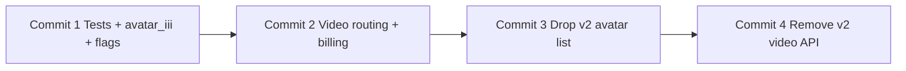

# HeyGen v2 → v3 implementation plan (4 commits)

**Branch:** Work on your current branch (e.g. `heygenReveamp`). **Commits and PRs are manual** — one commit per phase below, in order.

**Goal:** Remove dependence on `POST /v2/video/generate` and `GET /v2/avatars` without changing editor HTTP contracts, without webhooks ( **polling stays** via `GET /v3/videos/{id}` ), and without shipping risky behavior in one big bang.

**Principles (system design)**

| Principle | How we apply it |
|-----------|-----------------|
| Minimal scope per commit | One concern per commit; easy review and rollback |
| Feature flags | Env toggles; default **safe** until the final commit |
| Tests with foundation | Commit 1 adds unit tests **and** additive v3 pieces (flags default off) |
| v3 replacement only | `POST /v3/videos` + `engine.type` (incl. `avatar_iii`); v3 avatar look GETs |
| No new infrastructure | No webhooks, no BullMQ for HeyGen in this plan |
| Gate each phase | **Do not start commit N+1** until phase N automated + manual checks pass |

**Related docs:** [HEYGEN_API_V3_MIGRATION_ASSESSMENT.md](HEYGEN_API_V3_MIGRATION_ASSESSMENT.md), [api/HEYGEN_PROJECT_VIDEOS_API.md](api/HEYGEN_PROJECT_VIDEOS_API.md)

---

## Environment flags (introduced in commit 1, tightened in commit 4)

| Variable | Default (commits 1–3) | Final (commit 4) | Meaning |
|----------|------------------------|------------------|---------|
| `HEYGEN_PREFER_V3_VIDEO` | `false` → then `true` in staging before commit 4 | `true` | Route III-only / eligible looks to v3 instead of v2 |
| `HEYGEN_ALLOW_V2_VIDEO_FALLBACK` | `true` | `false` | If v3 create fails, retry `POST /v2/video/generate` |

Document in `docs/api/ENVIRONMENT.md` in **commit 1**.

**Polling:** unchanged — `pollLatestStatus` in `src/modules/video/services/heygen.service.js` remains the completion path for sync/download.

---

## Overview: four commits ↔ four phases

| Phase | Commit (suggested message) | Production risk if merged alone |
|-------|-----------------------------|--------------------------------|
| 1 | `feat(heygen): add routing tests, avatar_iii v3 support, and migration flags` | **None** with defaults (`PREFER_V3=false`) |
| 2 | `feat(heygen): v3-first video create with v2 fallback and billing labels` | **Low** with `PREFER_V3=true` only in staging first |
| 3 | `refactor(heygen): remove v2 avatar list fallback` | **Low** — picker degradation only |
| 4 | `feat(heygen): remove v2 video generate and enable v3 by default` | **Medium** — requires phases 1–3 sign-off |

---

## Phase 1 / Commit 1 — Tests + Avatar III on v3 + flags (defaults = today’s behavior)

### Scope

**Tests (baseline + future flag behavior)**

- Add `src/shared/constants/heygen.test.js` using `node --test`.
- Cover `usesHeygenLegacyV2VideoApi` / `usesHeygenLegacyV2VideoLook`, `resolveVideoPlanForLook`, `buildHeygenVideoEnginePayload`.
- Fixtures: expressive id, `supported_api_engines: ['avatar_iii']`, IV/V, empty `[]`, studio/digital twin coercion.
- Add flag-on cases: III-only look → `videoApi: 'v3'`, `engine: 'avatar_iii'` when prefer-v3 is enabled (test via injectable flag helper, not only `process.env`).
- Append test file to `npm test` in `package.json`.
- Optional: `heygenVideoPayload.test.js` for v3 payload shape only (no HTTP).

**Additive production code (no routing change until commit 2 when flag is used in video service)**

- `HEYGEN_AVATAR_ENGINES.III = 'avatar_iii'`.
- `normalizeHeygenAvatarEngine`, `buildHeygenVideoEnginePayload`, engine extraction — recognize `avatar_iii`.
- `resolveVideoPlanForLook`: when `HEYGEN_PREFER_V3_VIDEO === 'true'`, III-only looks (no IV/V) → `videoApi: 'v3'`, `engine: 'avatar_iii'` (not expressive public yet — commit 2).
- `heygen.service.js` `buildHeyGenVideoPayload`: pass `avatar_iii` as `engine.type`.
- `src/shared/config/heygenVideoMigration.js` — single place to read env flags.

### Files

- `src/shared/constants/heygen.js`
- `src/shared/constants/heygen.test.js` (new)
- `src/shared/config/heygenVideoMigration.js` (new)
- `src/modules/video/services/heygen.service.js` (payload only)
- `package.json`
- `docs/api/ENVIRONMENT.md`

### Gate (before commit 2)

- [ ] `npm test` green (baseline + flag-on plan tests).
- [ ] `npm run lint` on touched files.
- [ ] Staging `HEYGEN_PREFER_V3_VIDEO=false` — one normal IV scene video (unchanged behavior).
- [ ] Staging `HEYGEN_PREFER_V3_VIDEO=true` — **one** III-only look: plan resolves to v3 in tests; optional manual `POST /v3/videos` via same payload builder if you wire a quick internal check (full create flow lands in commit 2).

---

## Phase 2 / Commit 2 — v3-first create, v2 fallback, billing alignment

### Scope

- `createHeygenVideoJob` / `generateAvatarVideo` use plan from commit 1 when flags allow.
- **`HEYGEN_ALLOW_V2_VIDEO_FALLBACK`**: after IV↔V v3 retries, optional v2 retry if flag true — order: v3 (`avatar_iii`) → IV/V → v2.
- `requestHash`: v3 `avatar_iii` uses `avatar_iii` in hash (not `legacy_v2`); document one-time new job if users re-render after migration.
- `billingContext`: `avatar_iii` + `heygenApiVersion: 'v3'` when applicable; `legacy_v2` only when v2 fallback actually ran.
- `creditPricing`: map `legacy_v2` → `avatar_iii` for estimates where needed (`enterpriseHeygenCreditsPerSec`).
- **Expressive public looks:** with `HEYGEN_PREFER_V3_VIDEO=true`, try v3 when metadata has `avatar_iii` / IV / V; else v2 fallback — **do not** delete v2 client in this commit.
- Optional (if staging IV still passes): default `voice_settings.engine_settings` on v3 create.
- `enrichLookWithEngineHints`: `avatar_iii` in UI buckets where appropriate.

### Files

- `src/modules/video/services/heygen.service.js`
- `src/shared/constants/heygen.js` (expressive rules)
- `src/shared/config/creditPricing.js` (if needed)
- `src/shared/constants/heygen.test.js`

### Gate (before commit 3)

- [ ] `npm test` green.
- [ ] Staging `PREFER_V3=true`, `ALLOW_V2_FALLBACK=true`:
  - [ ] Photo + IV — pass
  - [ ] Digital twin / studio + V — pass
  - [ ] III-only — v3, billing `avatar_iii`
  - [ ] One expressive public look — pass or documented v2 fallback
  - [ ] WebM rules unchanged
  - [ ] Idempotent re-POST same scene
- [ ] Credits spot-check (enterprise vs PAYG).
- [ ] Matrix [HEYGEN_API_V3_MIGRATION_ASSESSMENT.md §8](HEYGEN_API_V3_MIGRATION_ASSESSMENT.md) rows **1–7**.

---

## Phase 3 / Commit 3 — Remove `GET /v2/avatars` fallback

### Scope

- Remove `collectV2AvatarLookCandidates` and `getJsonSafe('/v2/avatars')` from `heygenV3.service.js`.
- v3-only recovery: group GET, per-look GET, slug heuristics (existing).
- `warn` log when `listDegraded` / `heygenListUnavailable`.

### Files

- `src/modules/heygen/heygenV3.service.js`

### Gate (before commit 4)

- [ ] `npm test` green.
- [ ] Avatar looks API for quirky group — looks or clear degradation, no 500.
- [ ] Shared workspace avatar list — unchanged.
- [ ] One video create smoke — no regression.

### Manual

- Picker: private + `workspace_id` on TEAM workspace.

---

## Phase 4 / Commit 4 — Remove v2 video generate; defaults to v3-only

### Preconditions

- [ ] Staging ≥1 week with `PREFER_V3=true`, `ALLOW_V2_FALLBACK=true`, and **zero** v2 creates in logs (or product sign-off for remaining expressive set).
- [ ] Phases 1–3 gates checked off.

### Scope

- Delete `createVideoV2`, `buildHeyGenV2VideoPayload`, v2 branch in `createHeygenVideoJob`; remove obsolete v2 retry paths; keep IV↔V v3 retry.
- Defaults: prefer v3 on when unset; disallow v2 fallback when unset (or delete fallback code).
- Prune dead `videoApi: 'v2'` branches where safe; keep WebM / expressive messaging if still needed.
- Docs: `HEYGEN_API_V3_MIGRATION_ASSESSMENT.md`, `HEYGEN_PROJECT_VIDEOS_API.md`, `PROJECT_EDITOR_INTEGRATION.md`, Postman if needed.
- Grep: no `v2/video`, `/v2/avatars`, `createVideoV2` in `src/` (except historical docs).

### Files

- `src/modules/heygen/heygenV3.service.js`
- `src/modules/video/services/heygen.service.js`
- `src/shared/constants/heygen.js`
- Docs / Postman

### Gate (release)

- [ ] `npm test` + `npm run lint`.
- [ ] Staging: no v2 calls; full matrix §8 rows **1–10** (no webhook row).
- [ ] Prod: monitor `POST .../heygen/videos` errors 48h.

### Rollback

- Revert commit 4 on `heygenReveamp` if needed; tag pre-migration deploy.

---

## End-to-end verification (after commit 4)

| # | Case | Expected |
|---|------|----------|
| 1 | Public IV look, MP4 | v3, S3, credits |
| 2 | Studio/digital twin, V | v3 |
| 3 | III-metadata look | v3, billing `avatar_iii` |
| 4 | Expressive public | v3 or documented exception |
| 5 | WebM (non-legacy) | completed |
| 6 | Same scene hash re-POST | idempotent |
| 7 | TEAM shared avatar | access + render |
| 8 | Degraded looks list | no v2 |
| 9 | Project speech TTS | unchanged |
| 10 | Sync/download | poll only, no webhook |

**Automated:** `heygen.test.js` + full `npm test`.

---

## What we explicitly do **not** do

- HeyGen webhooks or poll reduction.
- `/v3/models/audio/*` voice migration.
- Video Agent, studio batches, frontend contract changes.

---

## Commit checklist summary

| # | One-line intent | Safe on default flags? |
|---|-----------------|------------------------|
| 1 | Tests + `avatar_iii` + flags (off) | Yes |
| 2 | v3-first + v2 fallback + billing | Staging-first |
| 3 | Drop v2 avatar catalog | After picker test |
| 4 | Remove v2 video API | After burn-in |

**Rule:** Do not commit phase **N+1** until phase **N** gate is checked off.

When you want code here, say **“implement phase 1”** (etc.); you commit on `heygenReveamp`.