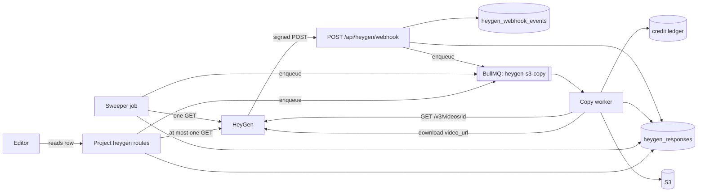
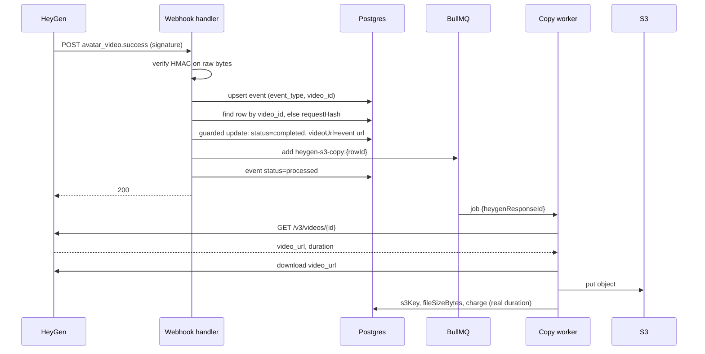
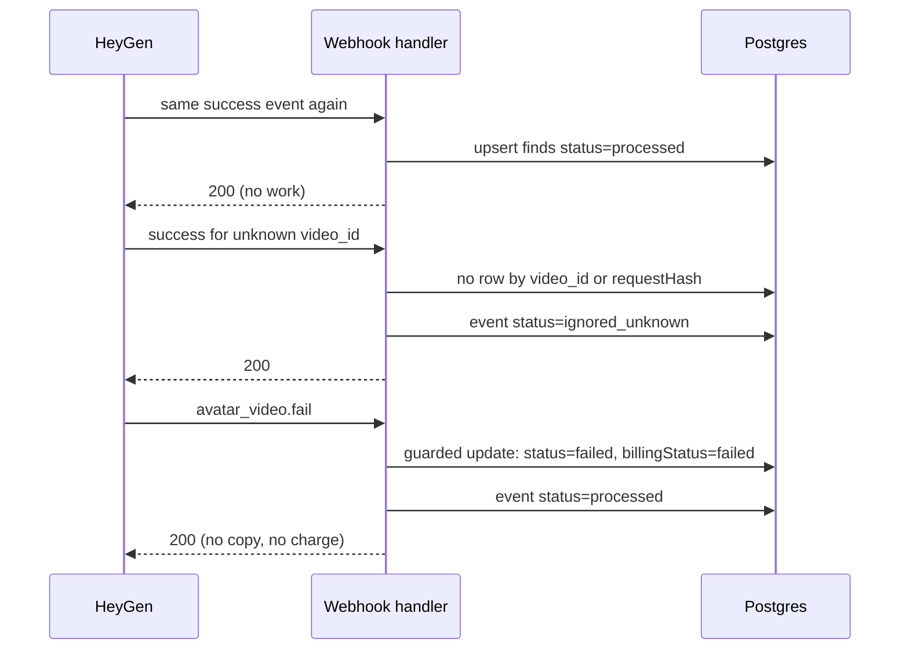
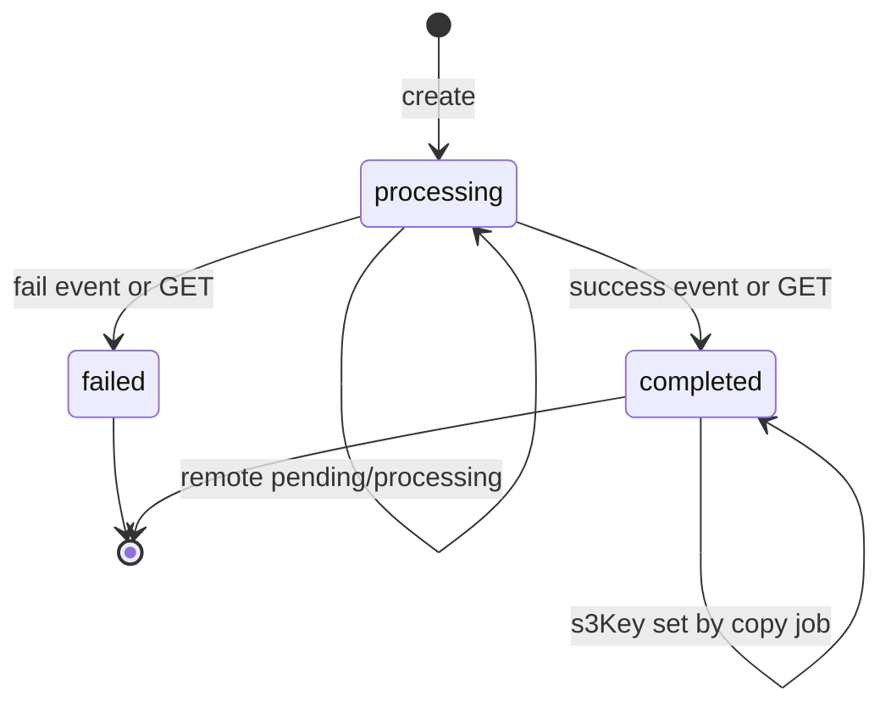

# HeyGen webhooks — detailed implementation plan (Phase 0)

**Status:** Plan only. No webhook code has been written.
**Last updated:** 18 November 2026
**Audience:** Backend engineers building Phase 0 webhooks, the QA engineer writing the tests, and reviewers.
**Covers:** PRD requirements FR-W1 to FR-W10 and Phase 0 work items 0.1–0.6 and 0.9.
**Source PRD:** *Athena Virtual Studio — Hybrid Video Rendering, PRD and 4-Month Delivery Plan*, draft v2.0.
**Official HeyGen docs:** [Webhooks](https://developers.heygen.com/docs/webhooks), [Webhook events](https://developers.heygen.com/docs/webhook-events), [Create endpoint](https://developers.heygen.com/reference/create-webhook-endpoint), [Create video](https://developers.heygen.com/reference/create-video).

This is the build spec for the webhook slice of Phase 0. It records what HeyGen sends, what our code does today, every file that changes, the exact behaviour of each new piece, the database changes, the test list, and the order the work ships in. Someone who has not read the PRD should be able to build from this document alone.

Out of scope here: item 0.7 (moving server renders to BullMQ with a separate worker process) and item 0.8 (scene-cache hit rate and credit reservation). Section 16 notes where this slice prepares for 0.7.

Related docs:

| Doc | Why |
|-----|-----|
| [`CLIENT_RENDERING_RECOMMENDATIONS.md`](CLIENT_RENDERING_RECOMMENDATIONS.md) | The wider hybrid-render recommendation this plan sits under |
| [`api/HEYGEN_PROJECT_VIDEOS_API.md`](api/HEYGEN_PROJECT_VIDEOS_API.md) | The polling contract the editor uses today. FR-W10 rewrites it |
| [`api/ENVIRONMENT.md`](api/ENVIRONMENT.md) | Where the new env vars get documented (FR-W7) |
| [`api/CREDITS_API.md`](api/CREDITS_API.md) | How workspace credits are charged |

---

## Contents

1. [Summary](#1-summary)
2. [Scope](#2-scope)
3. [Decisions](#3-decisions)
4. [HeyGen contract](#4-heygen-contract)
5. [Current code](#5-current-code)
6. [Target design](#6-target-design)
7. [Data model and migration](#7-data-model-and-migration)
8. [Configuration](#8-configuration)
9. [File-by-file changes](#9-file-by-file-changes)
10. [Component specs](#10-component-specs)
11. [HTTP response matrix](#11-http-response-matrix)
12. [Failure modes and recovery](#12-failure-modes-and-recovery)
13. [Logging and observability](#13-logging-and-observability)
14. [Security](#14-security)
15. [Tests](#15-tests)
16. [Rollout](#16-rollout)
17. [Editor (frontend) impact](#17-editor-frontend-impact)
18. [Docs and Postman](#18-docs-and-postman)
19. [Task breakdown](#19-task-breakdown)
20. [Open questions](#20-open-questions)
21. [Acceptance checklist](#21-acceptance-checklist)
22. [Appendix A — local environment](#appendix-a--local-environment)
23. [Appendix B — runbooks](#appendix-b--runbooks)

---

## 1. Summary

Today the backend learns that a HeyGen avatar video is finished by polling HeyGen up to 24 times, 1.5 seconds apart (about 36 seconds), inside the editor's own HTTP request. Generation takes minutes, so the loop rarely sees completion, it blocks the request, and it repeats on every editor read. The finished file is copied to S3 by an in-process task that a restart loses.

After this work:

- HeyGen calls `POST /api/heygen/webhook` when a video succeeds or fails. The request is trusted only if its HMAC signature matches.
- The webhook handler updates the database row, enqueues a durable BullMQ job to copy the file to S3, and returns 200 in well under 2 seconds. It never downloads the file.
- The copy job asks HeyGen for the video once, downloads the fresh file URL, uploads to S3, and charges credits using HeyGen's real clip length.
- Editor reads hit our database. A single HeyGen status call happens only in three narrow cases, and never in a loop.
- A sweeper catches anything a missed webhook leaves behind.

---

## 2. Scope

### 2.1 Requirements

| ID | Requirement | Priority |
|----|-------------|----------|
| FR-W1 | `POST /api/heygen/webhook`. No JWT. The signature is the only trust. | P0 |
| FR-W2 | Verify hex HMAC-SHA256 of the **raw body** with the endpoint secret, in constant time. Capture raw bytes on this route only. | P0 |
| FR-W3 | Respond 2xx within 10 seconds (target under 2). Verify, update the row, enqueue the S3 copy, respond. Never wait for the download. | P0 |
| FR-W4 | Idempotency: unique record on `(event_type, video_id)`, and on `event_id` when present. Idempotent status transitions. No age check: HeyGen retries for up to 24 hours and sends no signed timestamp. | P0 |
| FR-W5 | Already completed with `s3Key`: 200, no-op. Unknown `video_id`: log, 200. | P0 |
| FR-W6 | Handle `avatar_video.success` and `avatar_video.fail` through `applyRemoteStatusToRecord`. | P0 |
| FR-W7 | One endpoint and secret per environment (dev, staging, production). Document `HEYGEN_WEBHOOK_SECRET`. | P0 |
| FR-W8 | Replace the 24-step loop with one status GET, only when: the editor opens a still-processing row, a render needs an uncopied file, or the sweeper finds a stuck row. | P0 |
| FR-W9 | Run one legacy v2 job (`createVideoV2`) and confirm it emits `avatar_video.success` before removing that path's loop. | P0 |
| FR-W10 | Update `api/HEYGEN_PROJECT_VIDEOS_API.md` so the editor stops tight-looping. | P1 |

### 2.2 Phase 0 work items covered

| Item | What | Where in this plan |
|------|------|--------------------|
| 0.1 | Confirm public URLs, register one endpoint per environment, store each secret | Section 16.3, Appendix B.1 |
| 0.2 | Route: no JWT, raw body, constant-time HMAC, unique event record, status update, enqueue, 200 | Sections 10.1–10.4 |
| 0.3 | Handler rules: completed no-op, unknown 200, no age check, charging | Sections 3.1, 10.4 |
| 0.4 | Durable BullMQ copy job, retire the in-process set | Sections 10.6–10.7 |
| 0.5 | Remove the 24-step poll, keep one GET for three cases, add the sweeper | Sections 10.8–10.10 |
| 0.6 | Confirm the v2 path emits the success event | Section 10.12, Appendix B.4 |
| 0.9 | Docs and tests | Sections 15, 18 |

### 2.3 Not in this slice

- Other HeyGen event types (captions, translations, photo avatars, and so on).
- Moving the Remotion render queue (`renderQueue.js`) to BullMQ (item 0.7).
- Streaming the download straight to S3 instead of buffering it in memory. Worth doing later. Not needed for correctness.
- Charging for trimmed length (section 3.2).

---

## 3. Decisions

All locked on 18 November 2026 unless marked otherwise.

### 3.1 HeyGen billing uses the real clip length

The webhook payload carries no duration. The copy job calls `GET /v3/videos/{video_id}` once, and `chargeHeygenVideoIfNeeded` uses the `duration` from that response.

- If the GET fails, the job retries with backoff. It does **not** fall back to the script estimate just because the call failed. A charge only runs once HeyGen has answered.
- If HeyGen answers but returns no duration, use `estimateDurationFromScript` (150 words/minute, 5 second floor) and log `heygen_duration_missing`.
- The idempotency key `heygen-video:${heygenResponseId}` stays. `CreditTransaction.idempotencyKey` is `@unique` in the schema, so two concurrent charges cannot both succeed.
- The copy job downloads the file from `video_url` in that same GET response. It never downloads the webhook's `event_data.url`, which HeyGen documents as a short-lived presigned link.

### 3.2 The HeyGen charge and the final export charge are separate

| Charge | Feature | Length used | When | Idempotency key |
|--------|---------|-------------|------|-----------------|
| Avatar clip | `HEYGEN_VIDEO` | Raw clip length from `GET /v3/videos/{id}` | After the clip is in S3 | `heygen-video:${heygenResponseId}` |
| Final export | `REMOTION_EXPORT` | Composition `durationInFrames / fps` in `chargeRenderIfNeeded` (`render.service.js`) | When the project render completes | `project-render:${renderId}` |

Editing the timeline does not change the HeyGen charge. A trimmed avatar element is still charged for the full generated clip, because HeyGen billed us for generating it. The export charge follows the edited timeline. The two numbers are allowed to differ.

### 3.3 Raw body with `express.raw` on one route

The route uses `express.raw({ type: '*/*', limit: '1mb' })`, mounted on `app` before the global `express.json()`. HeyGen's own Node sample does the same.

The PRD mentions an `express.json({ verify })` hook. That also satisfies FR-W2. `express.raw` is preferred because:

- It does not depend on HeyGen sending exactly `Content-Type: application/json`. The `verify` hook only runs when `express.json` decides to parse.
- It does not run this route through the 32 MB global JSON parser.
- The bytes HMAC'd are exactly the bytes received. Nothing else touches them first.

### 3.4 `callback_id` is our `requestHash`

Every create call sends `callback_id = requestHash`. The hash is computed before the HeyGen call, it is already `@unique` on `HeygenResponse`, and HeyGen echoes it back in the webhook. It gives a second way to find the row if `video_id` lookup misses. The v2 create body must be checked for `callback_id` support (item 0.6).

### 3.5 Log to console only

As of 18 November 2026, `src/shared/utils/logger.js` writes to the console only. `error.log` and `combined.log` were removed. All logging in this plan goes through `logger` and lands in stdout.

### 3.6 Unknown video returns 200

Per FR-W5. To cover the race where the webhook arrives before our row is saved, the create path applies any parked event right after it saves the row (section 10.4, step 5).

---

## 4. HeyGen contract

Checked against `developers.heygen.com` on 18 November 2026. The older `docs.heygen.com/docs/...` webhook pages return 404.

### 4.1 Endpoint management

All calls use `X-Api-Key` and `https://api.heygen.com`.

| Call | Purpose | Notes |
|------|---------|-------|
| `POST /v3/webhooks/endpoints` | Create | Body: `url` (public HTTPS), `events` (array, or null for all), optional `entity_id`. Returns `endpoint_id` and `secret`. |
| `GET /v3/webhooks/endpoints` | List | Paged (`limit` 1–100, `token`). `secret` is `null` here. |
| `PATCH /v3/webhooks/endpoints/{id}` | Update | `events` is replaced, not merged. Always send both event names. |
| `DELETE /v3/webhooks/endpoints/{id}` | Delete | Permanent. |
| `POST /v3/webhooks/endpoints/{id}/rotate-secret` | Rotate | Returns a new `secret`. The old one stops working immediately. |
| `GET /v3/webhooks/event-types` | List event types | |
| `GET /v3/webhooks/events` | Delivery history | Filter by `event_type`, `entity_id`. Each item has `event_id`, `event_type`, `event_data`, `created_at`. |

Create returns 409 if an endpoint with the same URL already exists on the account. Create accepts an optional `Idempotency-Key` header.

The secret is returned **only** on create and on rotate. Store it immediately. If it is lost, rotate.

### 4.2 Signature

| Header | Value |
|--------|-------|
| `signature` | Hex-encoded HMAC-SHA256 of the raw request body, keyed with the endpoint secret. Header names are case-insensitive. |

There is no timestamp and no version prefix. Re-serializing the parsed JSON breaks the HMAC, because whitespace and key order can change.

### 4.3 Body

```json
{
  "event_type": "avatar_video.success",
  "event_data": {
    "video_id": "…",
    "url": "https://…presigned…",
    "gif_download_url": "https://…",
    "video_page_url": "https://…",
    "video_share_page_url": "https://…",
    "folder_id": null,
    "callback_id": "…"
  }
}
```

| Field | Use |
|-------|-----|
| `event_type` | Routing. Only the two avatar events are handled. |
| `event_data.video_id` | Primary lookup key and half the dedupe key. |
| `event_data.url` | Short-lived presigned file URL. Stored as `videoUrl` for early playback only. Never downloaded by the copy job. |
| `event_data.callback_id` | Our `requestHash`. Second lookup key. |
| `event_data.gif_download_url`, `video_page_url`, `video_share_page_url`, `folder_id` | Kept in the stored payload. Not used. |

Not in the published success schema:

- **`duration`.** Hence decision 3.1.
- **`event_id`.** It appears in the delivery-history API. Store it if the pushed body includes it. Never require it.

`avatar_video.fail` fields are not published. Treat it as a failure signal, store the raw body, and read an error message from `event_data.msg`, `event_data.message`, or `event_data.error` if any is present.

### 4.4 Delivery

- 2xx within 10 seconds counts as delivered.
- Anything else, including a timeout, is retried with exponential backoff for up to 24 hours.
- A retry resends the same payload.
- HeyGen's dedupe guidance: `event_type` + `event_data.video_id`, or `callback_id`.

### 4.5 Callback fields on create

`POST /v3/videos` accepts `callback_url` (one-off URL) and `callback_id` (echoed back). We use the registered endpoint, not `callback_url`, and send only `callback_id`.

---

## 5. Current code

Paths as of 18 November 2026. Search the symbol if a line has moved.

### 5.1 Where HeyGen videos live

| Piece | File |
|-------|------|
| Project-scoped routes | `src/modules/video/heygenVideo.routes.js`, mounted under `/api/workspaces/:workspaceId/projects/:projectId/heygen` |
| Controller | `src/modules/video/heygenVideo.controller.js` |
| Service | `src/modules/video/services/heygen.service.js` |
| DAO | `src/modules/video/heygen.dao.js` |
| HeyGen API calls | `src/modules/heygen/heygenV3.service.js` |
| HTTP client | `src/shared/services/heygenV3.client.js` |
| Row | `HeygenResponse` in `prisma/schema.prisma` |

### 5.2 Polling loop

`heygen.service.js`:

- `POLL_INTERVAL_MS = 1500`, `MAX_POLL_ATTEMPTS = 24`.
- `pollLatestStatus(videoId)` calls `heygenV3Service.getVideoStatus` up to 24 times.
- `refreshHeygenVideoStatus(record, { poll = true, queueS3 = true })` polls when `poll` is true, then calls `applyRemoteStatusToRecord`, then `queueHeygenVideoS3Upload` if completed without `s3Key`.
- `syncHeygenVideoToS3AndDb(record, { poll = true })` refreshes, then copies to S3 **inside the request**, waiting on any in-flight copy.

Who reaches the loop:

| Caller | Reached from | Mode |
|--------|--------------|------|
| `getProjectHeygenVideo` | `GET .../heygen/videos/:heygenVideoId` | `sync=status` (default) polls; `sync=full` polls and copies in the request; `sync=none` reads the row |
| `assertHeygenVideoPlayable` | `GET` and `HEAD .../stream`, and `GET .../download` via `getPresignedDownloadForVideo` | `sync=status`, then a full sync if completed but not playable |
| `assertHeygenVideoReadyInS3` | `GET .../s3-location`, and `render.service.js` `resolveElementContent` for every avatar element in a render | `sync=full` |

So an editor `HEAD /stream` on a processing video blocks up to ~36 seconds, and a render with several avatar scenes can poll and download each one inline.

### 5.3 `applyRemoteStatusToRecord(record, remote)`

- `remote.status === 'failed'` → `status: failed`, `billingStatus: failed`, `rawResponse`.
- any other non-`completed` status → writes that status and `rawResponse`.
- `completed` → `status: completed`, `rawResponse`, and `videoUrl` from `heygenPlaybackUrl(record, remote)`.

It does not copy and does not charge. There is **no transition guard**: a stale `processing` can overwrite `completed`.

Expected `remote` shape (from `normalizeVideoStatusResponse` in `heygenV3.service.js`):

```js
{ id, status, video_url, thumbnail_url, duration, error, raw }
```

`status` is lower-cased. `duration` is a number of seconds or null.

### 5.4 `createVideoV2`

`heygenV3.service.js` → `createVideoV2(jsonBody)` posts `/v2/video/generate` and returns `{ videoId, status, raw, apiVersion: 'v2' }`. `createHeygenVideoJob(payloadBody, { useLegacyV2 })` chooses v2 when `resolveVideoEngineForAvatar` says so (expressive public studio looks), and as a fallback after some v3 engine errors. `buildHeyGenV2VideoPayload` builds the v2 body. Status for v2 jobs is read through `GET /v3/videos/:id` like any other.

### 5.5 `copyHeygenVideoToS3(record, remote)` and the in-process queue

`copyHeygenVideoToS3`:

1. Return early if `record.s3Key` is set.
2. `sourceUrl = heygenPlaybackUrl(record, remote)`, which prefers `remote.video_url` and falls back to `record.videoUrl`.
3. `downloadVideoBuffer(sourceUrl)`: `fetch`, whole body into memory, no timeout. On non-2xx it throws `AppError(HEYGEN_PROXY_FETCH_FAILED, 502)` (that message text says "audio", which is wrong for video; fix it in passing).
4. Storage checks: `getWorkspaceOwnerOrThrow`, `recalculateUserStorageUsed`, `assertOwnerCanFitAdditionalBytes` (throws `AppError(STORAGE_LIMIT_EXCEEDED, 400)`).
5. Key from `buildHeygenSceneVideoKey(...)`, which is deterministic per row and output format.
6. `uploadFileToKey(buffer, key, contentType)`.
7. Update the row: `folderId`, `status: completed`, `s3Key`, `videoUrl` (S3 URL), `fileSizeBytes`, `rawResponse`.
8. `chargeHeygenVideoIfNeeded(updated, remote)`.
9. `recalculateProjectStorage`, `recalculateUserStorageUsed`.

`queueHeygenVideoS3Upload(record, remote)` starts that as a fire-and-forget task held in the `s3UploadInflight` Map, swallows errors, and forgets it on finish. A restart loses it.

### 5.6 `chargeHeygenVideoIfNeeded(record, remote, avatarEngine)`

- No-op if `billingStatus` is `charged` or `skipped`.
- `skipped` if there is no `triggeredByUserId`.
- `durationSeconds = remote.duration > 0 ? remote.duration : estimateDurationFromScript(billingContext.script)`.
- Prices with `calculateUsageCredits({ feature: HEYGEN_VIDEO, durationSeconds, avatarEngine, avatarType, resolution })`.
- `creditLedger.chargeUsage(...)` with `idempotencyKey: heygen-video:${record.id}`.
- Sets `billingStatus: charged`, `creditsCharged`, `billedDurationSec`.

Note: it reads `remote.duration` directly, so calling it with `remote = null` throws. The copy job always passes the GET result.

### 5.7 Express setup

`src/app.js` order today: CORS → helmet → compression → `express.json({ limit: JSON_BODY_LIMIT || '32mb' })` → cookieParser → urlencoded → morgan → routers → errorHandler.

`src/modules/heygen/heygen.routes.js` calls `router.use(authMiddleware)` for everything under `/api/heygen`. A webhook route inside that router would return 401. The webhook is mounted on `app` directly, before the `/api/heygen` router and before `express.json()`.

### 5.8 Redis and background jobs

- `src/shared/config/redis.js` uses the `redis` (node-redis) package. `connectRedis()` runs at app load. In development, Redis is optional unless `REDIS_OPTIONAL=false`.
- `bullmq` 6.7.7 is installed. Shared options live in `src/shared/queues/bullmqConnection.js`. No queue or worker is started yet. The copy queue and the sweeper are still to build.
- `src/modules/render/renderQueue.js` is a single-process promise chain.
- Background jobs are `setInterval` timers in `src/shared/jobs/*`, started from `src/server.js` after `listen`.
- `src/server.js` shutdown: on SIGINT/SIGTERM it disconnects Prisma and closes the HTTP server.

### 5.9 Tests

- `npm test` runs `scripts/run-node-tests.js` with an explicit list of files from `package.json`, plus everything in `src/modules/presentation/test/`.
- Flow tests stub modules through `require.cache` before requiring the service. Pattern from `src/modules/imageGen/imageGen.social.flow.test.js`:

```js
function stub(relPath, exports) {
  const file = require.resolve(path.join(SRC, relPath));
  require.cache[file] = { id: file, filename: file, loaded: true, exports };
}
```

---

## 6. Target design

### 6.1 Components



### 6.2 Success path



### 6.3 Duplicate, unknown, and fail paths



### 6.4 Row states

`HeygenResponse.status`:



Transitions that the guard must refuse:

| From | To | Action |
|------|----|--------|
| `completed` | `processing`, `pending`, `waiting` | Ignore |
| `failed` | `processing`, `pending`, `waiting` | Ignore |
| `completed` with `s3Key` | `failed` | Ignore and log `heygen_status_conflict` |
| `completed` without `s3Key` | `failed` | Apply. HeyGen's latest word wins when we hold no file |
| `failed` | `completed` | Apply and log `heygen_status_conflict`. HeyGen sometimes reports a late success |
| any | `s3Key: null` | Never written |

`billingStatus`: `pending` → `charged` | `skipped` | `failed`. Only the copy job sets `charged`. Only a fail sets `failed`.

---

## 7. Data model and migration

### 7.1 New model

```prisma
model HeygenWebhookEvent {
  id               String    @id @default(uuid())
  eventType        String    @map("event_type")
  videoId          String    @map("video_id")
  eventId          String?   @unique @map("event_id")
  callbackId       String?   @map("callback_id")
  heygenResponseId String?   @map("heygen_response_id")
  status           String    @default("received")
  error            String?
  payload          Json
  attempts         Int       @default(1)
  receivedAt       DateTime  @default(now()) @map("received_at")
  processedAt      DateTime? @map("processed_at")

  @@unique([eventType, videoId])
  @@index([heygenResponseId])
  @@index([status, receivedAt])
  @@map("heygen_webhook_events")
}
```

`status` values:

| Value | Meaning | Retry runs work again? |
|-------|---------|------------------------|
| `received` | Row written, processing not finished | Yes |
| `processed` | Row updated and copy enqueued (success), or row failed (fail) | No |
| `ignored_unknown` | No matching `HeygenResponse` | No, but the create path re-applies it (section 10.4 step 5) |
| `ignored_noop` | Row already completed with `s3Key` | No |
| `failed` | Our side threw after the upsert | Yes |

`heygenResponseId` is a plain nullable string, not a foreign key with cascade. Deleting a project must not delete the audit trail, and an unknown event has no row to point at.

`payload` stores the full verified body. It contains a presigned URL that expires; that is acceptable for an audit table. Do not log it.

### 7.2 Changes to `HeygenResponse`

```prisma
model HeygenResponse {
  // existing fields unchanged
  copyFailedReason String?   @map("copy_failed_reason")
  copyFailedAt     DateTime? @map("copy_failed_at")

  @@index([projectId, workspaceId])
  @@index([videoId])
  @@index([status, updatedAt])
}
```

- `@@index([videoId])`: the webhook looks rows up by `videoId`. Today this column has no index.
- `@@index([status, updatedAt])`: the sweeper scans by status and age.
- `copyFailedReason`, `copyFailedAt`: set when the copy job gives up for a reason retries cannot fix (for example `storage_limit_exceeded`). The sweeper skips these rows for an hour so it does not retry a full quota every 5 minutes. Cleared on a successful copy.

### 7.3 Migration

One migration, named per the repo convention `YYYYMMDDHHMMSS_heygen_webhook_events` in `prisma/migrations/`. Generate it with `npx prisma migrate dev --name heygen_webhook_events`, and review the SQL before committing. It should be equivalent to:

```sql
CREATE TABLE "heygen_webhook_events" (
  "id" TEXT NOT NULL,
  "event_type" TEXT NOT NULL,
  "video_id" TEXT NOT NULL,
  "event_id" TEXT,
  "callback_id" TEXT,
  "heygen_response_id" TEXT,
  "status" TEXT NOT NULL DEFAULT 'received',
  "error" TEXT,
  "payload" JSONB NOT NULL,
  "attempts" INTEGER NOT NULL DEFAULT 1,
  "received_at" TIMESTAMP(3) NOT NULL DEFAULT CURRENT_TIMESTAMP,
  "processed_at" TIMESTAMP(3),
  CONSTRAINT "heygen_webhook_events_pkey" PRIMARY KEY ("id")
);
CREATE UNIQUE INDEX "heygen_webhook_events_event_id_key" ON "heygen_webhook_events"("event_id");
CREATE UNIQUE INDEX "heygen_webhook_events_event_type_video_id_key" ON "heygen_webhook_events"("event_type", "video_id");
CREATE INDEX "heygen_webhook_events_heygen_response_id_idx" ON "heygen_webhook_events"("heygen_response_id");
CREATE INDEX "heygen_webhook_events_status_received_at_idx" ON "heygen_webhook_events"("status", "received_at");

ALTER TABLE "HeygenResponse" ADD COLUMN "copy_failed_reason" TEXT, ADD COLUMN "copy_failed_at" TIMESTAMP(3);
CREATE INDEX "HeygenResponse_videoId_idx" ON "HeygenResponse"("videoId");
CREATE INDEX "HeygenResponse_status_updatedAt_idx" ON "HeygenResponse"("status", "updatedAt");
```

The table name `"HeygenResponse"` is confirmed in `prisma/migrations/20260502065529_heygen_response/migration.sql`. The model has no `@@map`, and later migrations alter that same table. The migration is additive only: new table, new nullable columns, new indexes. No backfill is needed. Existing `processing` rows are picked up by the sweeper.

On the shared Aiven dev database, `CREATE INDEX` on `HeygenResponse` takes a short lock. The table is small in dev. For production, check the row count first; if it is large, create the indexes `CONCURRENTLY` in a hand-written migration.

### 7.4 Retention

`heygen_webhook_events` grows by about one row per generated video. Add a cleanup to an existing daily job later (delete `processed` and `ignored_*` rows older than 90 days). Not required for launch.

---

## 8. Configuration

New and changed environment variables. Names marked *proposed* can change in review; whatever ships must be documented in `api/ENVIRONMENT.md`.

| Variable | Required | Default | Purpose |
|----------|----------|---------|---------|
| `HEYGEN_WEBHOOK_SECRET` | Yes, where webhooks are enabled | none | Endpoint signing secret. One per environment. Shown once by HeyGen. |
| `REDIS_URL` | Yes | none | Already exists. BullMQ uses it through its own connection. |
| `REDIS_OPTIONAL` | No | `true` in development | Set `false` anywhere the copy queue runs, so a dead Redis fails boot instead of silently disabling copies. |
| `HEYGEN_COPY_CONCURRENCY` *(proposed)* | No | `2` | Copy jobs per worker process. Each holds one video in memory. |
| `HEYGEN_COPY_ATTEMPTS` *(proposed)* | No | `6` | BullMQ attempts per copy job. |
| `HEYGEN_COPY_BACKOFF_MS` *(proposed)* | No | `30000` | First backoff delay. Exponential after that (30 s, 60 s, 2 min, 4 min, 8 min). |
| `HEYGEN_HTTP_TIMEOUT_MS` *(proposed)* | No | `15000` | Timeout for the status GET. |
| `HEYGEN_DOWNLOAD_TIMEOUT_MS` *(proposed)* | No | `600000` | Timeout for the file download (10 minutes). |
| `HEYGEN_SWEEP_INTERVAL_MS` *(proposed)* | No | `300000` | Sweeper cadence (5 minutes). |
| `HEYGEN_SWEEP_PROCESSING_AGE_MS` *(proposed)* | No | `900000` | Rows `processing` longer than this are checked (15 minutes). |
| `HEYGEN_SWEEP_UNCOPIED_AGE_MS` *(proposed)* | No | `300000` | Rows `completed` without `s3Key` longer than this are re-enqueued (5 minutes). |
| `HEYGEN_RENDER_COPY_WAIT_MS` *(proposed)* | No | `120000` | How long a render waits for an in-progress copy before returning 409. |

If `HEYGEN_WEBHOOK_SECRET` is unset, the route returns 500 on every call and logs `heygen_webhook_misconfigured`. That is deliberate: a missing secret must be loud, and HeyGen will retry for 24 hours once the secret is set.

Redis eviction: BullMQ needs `maxmemory-policy noeviction`, or queued jobs can be deleted. Checked on 18 November 2026: the Render Key Value used for dev is `allkeys-lru`, and Render does not allow changing that policy. `getBullmqConnectionOptions()` uses `BULLMQ_REDIS_URL` when set, otherwise `REDIS_URL`. Production sets `BULLMQ_REDIS_URL` to the ElastiCache primary endpoint, with a parameter group of `noeviction` and cluster mode disabled. Steps are in `docs/DEVOPS_DEPLOYMENT.md` section 12. Boot logs `bullmq_redis_ready` or `bullmq_redis_eviction_policy` and does not exit.

---

## 9. File-by-file changes

### 9.1 New files

| File | Exports | Responsibility |
|------|---------|----------------|
| `src/modules/heygenWebhook/heygenWebhook.routes.js` | `router` | `POST /` with `express.raw`, then the controller. No auth. |
| `src/modules/heygenWebhook/heygenWebhook.controller.js` | `handle` | Reads `req.body` (Buffer) and the `signature` header, calls the service, maps the result to a status code. |
| `src/modules/heygenWebhook/heygenWebhook.signature.js` | `verifyHeygenSignature(rawBody, signatureHeader, secret)` | Pure function. Returns `{ ok: true }` or `{ ok: false, reason }`. No I/O. |
| `src/modules/heygenWebhook/heygenWebhook.service.js` | `handleWebhook({ rawBody, signature })`, `applyParkedEventsForVideo(videoId)` | The handler flow in section 10.4. |
| `src/modules/heygenWebhook/heygenWebhook.dao.js` | `upsertEvent`, `markEvent`, `findParkedEventsByVideoId` | Prisma access for `HeygenWebhookEvent`. |
| `src/shared/queues/bullmqConnection.js` | `getBullConnection()`, `closeBullConnection()` | One shared ioredis connection config for BullMQ. |
| `src/shared/jobs/heygenVideoCopy.job.js` | `enqueueHeygenVideoCopy(heygenResponseId)`, `waitForHeygenVideoCopy(heygenResponseId, timeoutMs)`, `startHeygenVideoCopyWorker()`, `stopHeygenVideoCopyWorker()` | Queue, worker, enqueue and wait helpers. |
| `src/shared/jobs/heygenVideoSweep.job.js` | `startHeygenVideoSweepJob()`, `stopHeygenVideoSweepJob()`, `runHeygenVideoSweep()` | Repeatable sweeper. `runHeygenVideoSweep` is exported for tests. |
| `src/modules/heygenWebhook/heygenWebhook.signature.test.js` | | HMAC unit tests |
| `src/modules/heygenWebhook/heygenWebhook.service.test.js` | | Handler flow tests |
| `src/shared/jobs/heygenVideoCopy.job.test.js` | | Copy processor tests |
| `src/shared/jobs/heygenVideoSweep.job.test.js` | | Sweeper tests |

### 9.2 Modified files

| File | Change |
|------|--------|
| `package.json` | Add `bullmq`. Add the four test files to the `test` script list. |
| `prisma/schema.prisma` | Section 7. |
| `prisma/migrations/<timestamp>_heygen_webhook_events/migration.sql` | Section 7.3. |
| `src/app.js` | Mount the webhook router before `express.json()` (section 10.2). |
| `src/server.js` | Start the copy worker and the sweeper after `listen`. Close them in `shutdown` before `prisma.$disconnect()`. |
| `src/modules/video/heygen.dao.js` | Add `findHeygenResponseByVideoId`, `findHeygenResponseByRequestHash` (exists), `updateHeygenResponseGuarded`, `findStuckProcessingRows`, `findUncopiedCompletedRows`. |
| `src/modules/video/services/heygen.service.js` | Section 10.8. |
| `src/modules/heygen/heygenV3.service.js` | `getVideoStatus(videoId, { timeoutMs })` passes an abort signal. |
| `src/shared/services/heygenV3.client.js` | Accept an optional `signal` and pass it to `fetch`. |
| `src/modules/render/render.service.js` | No signature change. `assertHeygenVideoReadyInS3` now waits on the copy job instead of downloading inline. |
| `src/shared/utils/messages.js` | Fix `HEYGEN_PROXY_FETCH_FAILED` text (it says audio). Add `HEYGEN_WEBHOOK_SECRET_MISSING` if a message constant is wanted for logs. |
| `docs/api/ENVIRONMENT.md`, `docs/api/HEYGEN_PROJECT_VIDEOS_API.md`, `docs/api/QUICK_REFERENCE.md`, `AGENTS.md`, Postman | Section 18. |

---

## 10. Component specs

Code below is pseudocode to fix behaviour. It is not final code.

### 10.1 Signature verifier

```js
function verifyHeygenSignature(rawBody, signatureHeader, secret) {
  if (!secret) return { ok: false, reason: 'secret_missing' };
  if (!Buffer.isBuffer(rawBody)) return { ok: false, reason: 'body_not_raw' };
  const sig = String(signatureHeader || '').trim();
  if (!sig) return { ok: false, reason: 'signature_missing' };
  if (!/^[0-9a-f]+$/i.test(sig) || sig.length % 2 !== 0) {
    return { ok: false, reason: 'signature_malformed' };
  }
  const expected = crypto.createHmac('sha256', secret).update(rawBody).digest();
  const given = Buffer.from(sig, 'hex');
  if (given.length !== expected.length) return { ok: false, reason: 'signature_mismatch' };
  return crypto.timingSafeEqual(given, expected)
    ? { ok: true }
    : { ok: false, reason: 'signature_mismatch' };
}
```

Rules:

- Compare decoded bytes, not hex strings, so upper/lower-case hex both work.
- Check lengths before `timingSafeEqual`, which throws on unequal lengths.
- Never log the secret, the received signature, or the expected digest.

Test vector (use in unit tests):

| Input | Value |
|-------|-------|
| Secret | `test_webhook_secret` |
| Raw body | `{"event_type":"avatar_video.success","event_data":{"video_id":"vid_test_123","url":"https://example.com/v.mp4","callback_id":"hash_abc"}}` |
| Expected signature | `4afd51f116cb0558752cb677f8e94d351c84e342ae57a86998479b2a46e03aeb` |
| Same object re-serialized with 2-space indent | `cf9ec32949b4feed82ca4134f979ba0704656abc34100700f6055bba52a04d6e` (must **not** verify against the expected signature) |

Both values were computed with Node `crypto` and cross-checked with `openssl dgst -sha256 -hmac`.

### 10.2 Route and middleware order

`src/app.js`, after compression and before `express.json`:

```js
const heygenWebhookRoutes = require('./modules/heygenWebhook/heygenWebhook.routes');

app.use(createCorsMiddleware());
app.use(helmet());
app.use(compression({ /* unchanged */ }));
app.use('/api/heygen/webhook', heygenWebhookRoutes);   // raw body, no auth
app.use(express.json({ limit: jsonBodyLimit }));
// ... unchanged ...
app.use('/api/heygen', heygenRoutes);                  // still behind authMiddleware
```

`heygenWebhook.routes.js`:

```js
const router = express.Router();
router.post('/', express.raw({ type: '*/*', limit: '1mb' }), controller.handle);
```

Notes:

- Mounted with `app.use('/api/heygen/webhook', ...)` so the path is matched before the authenticated `/api/heygen` router. The handler ends the response, so the authenticated router never sees the request.
- CORS does not matter for a server-to-server POST. Helmet and compression are harmless.
- `morgan` is mounted later, so these requests are not access-logged by morgan. The controller logs its own line (section 13).
- A body over 1 MB makes `express.raw` throw a 413, which `errorHandler` already maps. A real success payload is well under 1 KB.

### 10.3 Controller

```js
const handle = async (req, res) => {
  const result = await heygenWebhookService.handleWebhook({
    rawBody: req.body,
    signature: req.get('signature'),
  });
  res.status(result.httpStatus).json({ received: result.httpStatus < 300 });
};
```

- Does not use `successResponse`. HeyGen ignores the body; a tiny JSON is enough.
- Not wrapped in `asyncHandler`'s generic error path for expected outcomes. The service returns an `httpStatus` for every expected case. An unexpected throw still reaches `errorHandler` and returns 500, which makes HeyGen retry.

### 10.4 Service: `handleWebhook`

```text
handleWebhook({ rawBody, signature }):
  1. secret = process.env.HEYGEN_WEBHOOK_SECRET
     if missing -> log heygen_webhook_misconfigured; return 500

  2. v = verifyHeygenSignature(rawBody, signature, secret)
     signature_missing                     -> return 400
     signature_malformed | mismatch        -> log heygen_webhook_bad_signature; return 401

  3. parse JSON from rawBody (utf8)
     invalid JSON                          -> return 400
     eventType = body.event_type
     videoId   = body.event_data?.video_id
     if eventType not in {avatar_video.success, avatar_video.fail}
                                           -> log heygen_webhook_ignored_type; return 200
     if !videoId                           -> log heygen_webhook_no_video_id; return 400

  4. event = dao.upsertEvent({ eventType, videoId, eventId: body.event_id ?? null,
                               callbackId: body.event_data.callback_id ?? null, payload: body })
       create: status=received, attempts=1
       update: attempts += 1   (payload not overwritten)
     if event.status in {processed, ignored_unknown, ignored_noop}
                                           -> log heygen_webhook_duplicate; return 200
     if a P2002 on event_id is raised      -> treat as duplicate; return 200

  5. row = heygenDao.findHeygenResponseByVideoId(videoId)
          ?? (callbackId && heygenDao.findHeygenResponseByRequestHash(callbackId))
     if !row -> dao.markEvent(event.id, 'ignored_unknown'); log heygen_webhook_unknown_video; return 200

  6. if row.status == 'completed' && row.s3Key
        -> dao.markEvent(event.id, 'ignored_noop', { heygenResponseId: row.id }); return 200

  7. remote = eventType == success
        ? { status: 'completed', video_url: event_data.url ?? null, duration: null, raw: body }
        : { status: 'failed', video_url: null, duration: null, error: failMessage(body), raw: body }
     updated = applyRemoteStatusToRecord(row, remote)   // guarded, section 10.5

  8. if updated.status == 'completed' && !updated.s3Key
        enqueueHeygenVideoCopy(updated.id)

  9. dao.markEvent(event.id, 'processed', { heygenResponseId: row.id, processedAt: now })
     log heygen_webhook_processed; return 200

  On any throw in steps 4–9:
     try dao.markEvent(event.id, 'failed', { error: message })   // best effort
     log heygen_webhook_error; return 503
```

Why 503 and not 200 on our failures: if we return 200 and the enqueue was lost, nothing retries until the sweeper runs. A 503 makes HeyGen retry, and step 4 lets the retry redo the work.

Order inside step 7–8 matters: write the row first, then enqueue. If the enqueue fails, the retry finds the row already completed without `s3Key` and enqueues again.

**Parked unknown events.** `applyParkedEventsForVideo(videoId)` finds `ignored_unknown` events for that `videoId` and runs steps 5–9 for each. `generateAvatarVideo` calls it right after every `saveHeygenResponse` (three call sites: normal, legacy v2 fallback, engine fallback). Wrap it so a failure there never fails the create request: log and continue. This closes the race where HeyGen finishes and calls us before our insert commits.

### 10.5 Transition guard

`applyRemoteStatusToRecord` keeps its signature and its role as the single status writer. Its writes go through a guarded DAO update:

```js
async function updateHeygenResponseGuarded(id, data, { allowFrom }) {
  const { count } = await prisma.heygenResponse.updateMany({
    where: { id, status: { in: allowFrom } },
    data,
  });
  return { applied: count === 1, row: await prisma.heygenResponse.findUnique({ where: { id } }) };
}
```

| Remote status | Allowed current statuses (`allowFrom`) | Data written |
|---------------|----------------------------------------|--------------|
| `failed` | `processing`, `pending`, `waiting`, `completed` (only when `s3Key` is null — add `s3Key: null` to the `where`) | `status: failed`, `billingStatus: failed`, `rawResponse` |
| `completed` | `processing`, `pending`, `waiting`, `failed`, `completed` | `status: completed`, `rawResponse`, `videoUrl` only when the row has no `s3Key` |
| anything else | `processing`, `pending`, `waiting` | `status`, `rawResponse` |

- When `applied` is false, return the current row unchanged and log `heygen_status_conflict` with both statuses.
- `s3Key` is never part of `data` here. Only the copy job sets it.
- Two deliveries racing both run `updateMany`; Postgres row locking serializes them, and both end in a valid terminal state.

### 10.6 BullMQ setup

Connection is already in `src/shared/queues/bullmqConnection.js`. Queues and workers take it as:

```js
const { Queue } = require('bullmq');
const { getBullmqConnectionOptions } = require('../../shared/queues/bullmqConnection');

const queue = new Queue('heygen-s3-copy', { connection: getBullmqConnectionOptions() });
```

- Confirmed against the installed package (`bullmq` 6.7.7): `Queue`, `Worker`, `Job.retry`, `Queue.upsertJobScheduler`, and `UnrecoverableError` all exist.
- Do **not** pass the node-redis client from `redis.js`. Pass `getBullmqConnectionOptions()` from `src/shared/queues/bullmqConnection.js`. Queues and workers each open their own connection from those options.
- `enableReadyCheck` from earlier drafts is not needed. BullMQ 6 reads `url` and `maxRetriesPerRequest`.

Queue `heygen-s3-copy`:

| Setting | Value | Why |
|---------|-------|-----|
| `jobId` | `heygen-s3-copy:${heygenResponseId}` | One live job per row |
| `attempts` | `HEYGEN_COPY_ATTEMPTS` (6) | About 15 minutes of retries in total |
| `backoff` | `{ type: 'exponential', delay: 30000 }` | |
| `removeOnComplete` | `{ age: 86400, count: 1000 }` | Keep a day for debugging |
| `removeOnFail` | `{ age: 604800 }` | Keep a week |

Worker:

| Setting | Value | Why |
|---------|-------|-----|
| `concurrency` | `HEYGEN_COPY_CONCURRENCY` (2) | Each job buffers a whole video |
| `lockDuration` | `120000` | Lock is renewed while the job runs; a dead worker's job is reclaimed after this |
| `stalledInterval` | `30000` | How often stalled jobs are checked |
| `maxStalledCount` | `2` | A job that stalls twice moves to failed instead of looping |

**Re-enqueue after a failed job.** BullMQ ignores `add` when a job with the same id still exists, including a retained failed job. `enqueueHeygenVideoCopy` must therefore:

```text
job = queue.getJob(jobId)
if !job                        -> queue.add(name, data, { jobId, ...opts })
else if state == 'failed'      -> job.retry()
else if state == 'completed'   -> job.remove(); queue.add(...)   // row still has no s3Key, so copy again
else                           -> no-op (waiting, delayed, active)
```

**Waiting on a job** (`waitForHeygenVideoCopy`): enqueue, then poll the row every 2 seconds until `s3Key` is set, the job is failed, or `timeoutMs` passes. Polling our database is cheap and avoids holding a `QueueEvents` connection open in every API process. Use it only on the render path.

**Startup and shutdown** in `src/server.js`:

```text
after listen:
  startHeygenVideoCopyWorker()
  startHeygenVideoSweepJob()

shutdown(signal):
  await stopHeygenVideoSweepJob()
  await stopHeygenVideoCopyWorker()   // worker.close(): waits for active jobs, bounded by the platform grace period
  await closeBullConnection()
  await prisma.$disconnect()
  server.close(...)
```

If the platform kills the process before active jobs finish, those jobs stall and are reclaimed after `lockDuration`. That is the "restart mid-copy" case, and it is safe because the S3 key is deterministic and the charge is idempotent.

**Redis unavailable.** If `REDIS_OPTIONAL=true` and Redis is down, do not start the worker or the sweeper, log `heygen_copy_queue_disabled` once, and make `enqueueHeygenVideoCopy` throw. The webhook then returns 503 and HeyGen retries. Do not silently fall back to the old in-process copy.

### 10.7 Copy job processor

```text
process(job):
  row = heygenDao.findHeygenResponseById(job.data.heygenResponseId)
  if !row                      -> return { skipped: 'row_gone' }         // project deleted
  if row.s3Key                 -> return { skipped: 'already_copied' }
  if row.status == 'failed'    -> return { skipped: 'row_failed' }

  remote = heygenV3Service.getVideoStatus(row.videoId, { timeoutMs: HEYGEN_HTTP_TIMEOUT_MS })
     throws (timeout, 429, 5xx)            -> rethrow (BullMQ retries, nothing charged)
  if remote.status == 'failed'             -> applyRemoteStatusToRecord(row, remote); return { skipped: 'remote_failed' }
  if remote.status != 'completed'          -> throw new Error('not_ready')     // retry later
  if !remote.video_url                     -> throw new Error('no_video_url')

  if remote.duration == null               -> log heygen_duration_missing

  buffer = download(remote.video_url, { timeoutMs: HEYGEN_DOWNLOAD_TIMEOUT_MS })
     403 / 404 / timeout                   -> throw (retry GETs a new URL)

  try:
     copyHeygenVideoToS3(row, remote, { buffer })   // storage checks, upload, row update, charge, recalc
  catch AppError(STORAGE_LIMIT_EXCEEDED):
     update row copyFailedReason='storage_limit_exceeded', copyFailedAt=now
     throw new UnrecoverableError('storage_limit_exceeded')   // BullMQ: no more attempts

  clear copyFailedReason/copyFailedAt
  return { copied: true, bytes: buffer.length, durationSec: remote.duration }
```

`copyHeygenVideoToS3` changes:

- New optional third argument `{ buffer }`. When given, skip its own download.
- Stop falling back to `record.videoUrl` for the download source. The job always passes `remote.video_url`.
- Keep passing `remote` into `chargeHeygenVideoIfNeeded`, so the real duration is billed.

What retries do and do not do:

| Failure | Retry? | Charged? |
|---------|--------|----------|
| GET times out or 5xx | Yes | No |
| HeyGen still processing | Yes | No |
| No `video_url` | Yes | No |
| Download 403/404/timeout | Yes, with a new URL from the next GET | No |
| Storage quota full | No (`UnrecoverableError`) | No |
| S3 upload fails | Yes | No |
| Charge fails after upload | Yes. The retry sees `s3Key` set and returns `already_copied` | **Not retried** — see open question 20.3 |

The last row is a real gap: once `s3Key` is set, the early return skips the charge. Fix it by changing the early return to: if `s3Key` is set and `billingStatus` is `pending`, run only the charge (with a fresh GET for duration), then return.

### 10.8 Changes inside `heygen.service.js`

| Function | Before | After |
|----------|--------|-------|
| `pollLatestStatus`, `POLL_INTERVAL_MS`, `MAX_POLL_ATTEMPTS`, `sleep` | 24-step loop | Deleted |
| `s3UploadInflight`, `queueHeygenVideoS3Upload` | In-process copy | Deleted. Callers use `enqueueHeygenVideoCopy` |
| `refreshHeygenVideoStatus(record, opts)` | Polls (default), applies, queues in-process copy | One `getVideoStatus` **only if** the row is not terminal. Applies through the guard. Enqueues the copy if completed without `s3Key`. The `poll` option is removed |
| `syncHeygenVideoToS3AndDb(record)` | Polls, then downloads and uploads in the request | Refreshes once if not terminal, enqueues the copy, then `waitForHeygenVideoCopy(row.id, HEYGEN_RENDER_COPY_WAIT_MS)`. Used only by the render path |
| `getProjectHeygenVideo(..., { sync })` | `status` polls, `full` copies inline | `none`: row only. `status` (default): `refreshHeygenVideoStatus` (at most one GET). `full`: same as `status`; it no longer copies in the request (keep accepting the value for compatibility) |
| `assertHeygenVideoPlayable` | `sync=status`, then full sync | `sync=status`. If completed with a HeyGen URL and no `s3Key`, it is playable now; the copy is already enqueued. Else 409 |
| `assertHeygenVideoReadyInS3` | `sync=full` (inline copy) | `syncHeygenVideoToS3AndDb` (wait on the job). 409 `HEYGEN_VIDEO_NOT_READY` on timeout |
| `getPresignedDownloadForVideo` | Calls `queueHeygenVideoS3Upload` when serving the HeyGen URL | Calls `enqueueHeygenVideoCopy` |
| `applyRemoteStatusToRecord` | Unguarded update | Guarded (section 10.5) |
| `copyHeygenVideoToS3` | Downloads itself, falls back to `record.videoUrl` | Section 10.7 |
| `generateAvatarVideo` | No `callback_id` | Adds `callback_id: requestHash` to the payload; calls `applyParkedEventsForVideo` after each save |
| `buildHeyGenVideoPayload`, `buildHeyGenV2VideoPayload` | | Accept and emit `callback_id` (v2 only if 10.12 confirms support) |

**Editor playback before S3.** The editor can play the clip from the HeyGen URL as soon as the webhook lands, because step 7 of the handler writes `event_data.url` to `videoUrl`. That URL expires. If the editor plays an expired URL, `/stream` fails; the copy job normally finishes within a minute or two, after which `/stream` serves S3. If this becomes a problem, `assertHeygenVideoPlayable` can do its one GET to refresh `videoUrl` when the row has no `s3Key` and `updatedAt` is older than the URL lifetime. Not needed for launch.

### 10.9 Sweeper

Runs every `HEYGEN_SWEEP_INTERVAL_MS`, as a BullMQ job scheduler on a small `heygen-maintenance` queue, so only one process runs each tick even with several API instances.

```text
runHeygenVideoSweep():
  stuck = findStuckProcessingRows(olderThan: now - HEYGEN_SWEEP_PROCESSING_AGE_MS, limit: 50)
  for each row (sequential, small delay between):
     remote = getVideoStatus(row.videoId)        // one GET
     applyRemoteStatusToRecord(row, remote)
     if completed and no s3Key -> enqueueHeygenVideoCopy(row.id)

  uncopied = findUncopiedCompletedRows(olderThan: now - HEYGEN_SWEEP_UNCOPIED_AGE_MS,
                                       excludeCopyFailedSince: now - 1h, limit: 100)
  for each row -> enqueueHeygenVideoCopy(row.id)

  log heygen_sweep_done { stuckChecked, uncopiedEnqueued, errors }
```

- One HeyGen error on one row is logged and the loop continues.
- `limit` keeps a backlog from hammering HeyGen. A backlog drains over several ticks.
- On first deploy, existing `processing` rows from before the webhook existed are cleared by this.
- Use `queue.upsertJobScheduler('heygen-sweep', { every: HEYGEN_SWEEP_INTERVAL_MS }, ...)`. That method exists on the installed BullMQ 6.7.7.

### 10.10 The three FR-W8 cases, mapped

| FR-W8 case | Code path | HeyGen calls |
|------------|-----------|--------------|
| Editor opens a still-processing row | `getProjectHeygenVideo` / `assertHeygenVideoPlayable` → `refreshHeygenVideoStatus` | At most 1 per request, and 0 once the row is terminal |
| A render needs an uncopied file | `assertHeygenVideoReadyInS3` → `syncHeygenVideoToS3AndDb` | At most 1, then wait on the job (the job itself makes 1) |
| The sweeper finds a stuck row | `runHeygenVideoSweep` | 1 per stuck row per tick |

The editor should also stop calling the status route in a tight loop (section 17), but the backend no longer depends on that.

### 10.11 `callback_id` on create

- v3: add `callback_id: requestHash` in `buildHeyGenVideoPayload`.
- v2: add it in `buildHeyGenV2VideoPayload` only after item 0.6 confirms v2 accepts it. If v2 rejects unknown fields, the create would fail, so this must be tested before shipping.
- The fallback paths compute a different hash (`legacyHash`, `fallbackRequestHash`). Each create sends the hash of the row it will save.

### 10.12 Legacy v2 confirmation (item 0.6)

1. Generate one video through the v2 path (an expressive studio look that `resolveVideoEngineForAvatar` sends to v2).
2. Confirm `avatar_video.success` arrives: ngrok inspector, or `GET /v3/webhooks/events?event_type=avatar_video.success&entity_id=<video_id>`.
3. Record whether `callback_id` came back.

Outcomes:

| Result | Action |
|--------|--------|
| Event arrives | Remove the poll for v2 like v3 |
| Event never arrives | Keep **one** status GET for v2 rows in `refreshHeygenVideoStatus` (still no loop), rely on the sweeper, and record it in the PR |
| v2 rejects `callback_id` | Do not send it on v2. Lookup by `video_id` only |

---

## 11. HTTP response matrix

For `POST /api/heygen/webhook`.

| Situation | Status | HeyGen retries? | Event row |
|-----------|--------|-----------------|-----------|
| `HEYGEN_WEBHOOK_SECRET` unset | 500 | Yes | none |
| No `signature` header | 400 | Yes | none |
| Signature not hex / wrong length / mismatch | 401 | Yes | none |
| Body over 1 MB | 413 | Yes | none |
| Body not JSON | 400 | Yes | none |
| Event type not handled | 200 | No | none |
| No `event_data.video_id` | 400 | Yes | none |
| Duplicate of a finished event | 200 | No | unchanged (`attempts` +1) |
| Unknown video | 200 | No | `ignored_unknown` |
| Row already completed with `s3Key` | 200 | No | `ignored_noop` |
| Success applied and copy enqueued | 200 | No | `processed` |
| Fail applied | 200 | No | `processed` |
| Database or Redis error after verification | 503 | Yes | `failed` (best effort) |
| Unexpected throw | 500 (errorHandler) | Yes | `received` or `failed` |

400/401 retries are wasted but harmless. They stop after 24 hours.

---

## 12. Failure modes and recovery

| Failure | What happens | Recovery |
|---------|--------------|----------|
| Webhook never arrives | Row stays `processing` | Sweeper checks it after 15 minutes. Editor open does one GET |
| Webhook arrives before our row is saved | `ignored_unknown`, 200 | `applyParkedEventsForVideo` after save. Sweeper as backstop |
| Duplicate delivery | Upsert finds `processed` | 200, no work |
| Our DB down during webhook | 503 | HeyGen retries for 24 hours |
| Redis down during webhook | Enqueue throws, 503 | HeyGen retries. Sweeper re-enqueues once Redis is back |
| Process killed mid-copy | Job lock expires | BullMQ reclaims the job after `lockDuration`. Same S3 key, idempotent charge |
| Presigned URL expired before download | Download 403 | Job retries; the next attempt GETs a new URL |
| HeyGen API down | GET fails | Job retries over ~15 minutes, then fails. Sweeper re-enqueues later |
| Storage quota full | `UnrecoverableError` | Row gets `copyFailedReason`. Sweeper retries after an hour. User needs more storage |
| Secret rotated, server still has the old one | Every delivery 401s | Deploy the new secret. HeyGen keeps retrying for 24 hours, so nothing is lost if fixed in time |
| Wrong secret deployed to production | Every delivery 401s | Same. Alert on `heygen_webhook_bad_signature` rate |
| Copy succeeded, charge failed | `s3Key` set, `billingStatus=pending` | Section 10.7 fix: job runs charge-only when `s3Key` is set and billing is pending. Sweeper should include such rows |
| HeyGen reports fail after we copied the file | Guard ignores it | Logged as `heygen_status_conflict` |

---

## 13. Logging and observability

All through `logger` (console). Structured fields, no secrets.

| Event | Level | Fields |
|-------|-------|--------|
| `heygen_webhook_received` | info | `eventType`, `videoId`, `bytes` |
| `heygen_webhook_bad_signature` | warn | `reason`, `bytes`, `ip` |
| `heygen_webhook_misconfigured` | error | none |
| `heygen_webhook_ignored_type` | info | `eventType` |
| `heygen_webhook_duplicate` | info | `eventType`, `videoId`, `attempts` |
| `heygen_webhook_unknown_video` | warn | `eventType`, `videoId`, `callbackId` |
| `heygen_webhook_processed` | info | `eventType`, `videoId`, `heygenResponseId`, `ms` |
| `heygen_webhook_error` | error | `eventType`, `videoId`, `error` |
| `heygen_status_conflict` | warn | `heygenResponseId`, `from`, `to` |
| `heygen_copy_started` / `heygen_copy_done` | info | `heygenResponseId`, `attempt`, `bytes`, `durationSec`, `ms` |
| `heygen_copy_failed` | warn/error | `heygenResponseId`, `attempt`, `reason`, `final` |
| `heygen_duration_missing` | warn | `heygenResponseId`, `videoId` |
| `heygen_copy_queue_disabled` | error | none |
| `heygen_sweep_done` | info | `stuckChecked`, `uncopiedEnqueued`, `errors`, `ms` |

Never log: the secret, the `signature` header, the expected digest, `event_data.url` or any presigned URL (they carry credentials in the query string), or the full payload.

Useful checks after launch:

- Count of `heygen_webhook_processed` per day roughly equals videos created.
- `heygen_webhook_bad_signature` should be zero outside a rotation.
- Sweeper `stuckChecked` should trend to near zero. A steady non-zero number means webhooks are being missed.
- `heygen_webhook_events` rows stuck in `received` or `failed` for more than an hour need a look.

---

## 14. Security

- The signature is the only trust. No IP allowlist (HeyGen does not publish source IPs).
- Constant-time comparison over decoded bytes, with a length check first.
- Body limit 1 MB on this route.
- No age check (no signed timestamp exists). Replays of a valid old event are harmless: dedupe and the transition guard make them no-ops.
- One secret per environment. Dev, staging, and production endpoints never share a secret or a URL.
- The HeyGen API key stays on the server. The editor never calls HeyGen.
- Presigned URLs from HeyGen are not logged.
- The route returns no internal detail in its body.
- Rate limiting: not needed for launch. If abuse shows up, a 401 storm is cheap to serve.

---

## 15. Tests

Runner: `node --test` through `scripts/run-node-tests.js`. Add each new file to the `test` script in `package.json`. Stub Prisma, S3, HeyGen, storage, credits, and the queue through `require.cache`, as in `imageGen.social.flow.test.js`.

### 15.1 Signature (`heygenWebhook.signature.test.js`)

No stubs.

| Test | Expect |
|------|--------|
| Test vector body + secret + expected signature | `ok: true` |
| Same, signature in upper-case hex | `ok: true` |
| Wrong secret | `signature_mismatch` |
| One byte of the body flipped | `signature_mismatch` |
| Re-serialized body (2-space indent) with the original signature | `signature_mismatch` |
| Empty or missing header | `signature_missing` |
| Non-hex header (`zz…`) | `signature_malformed` |
| Odd-length hex | `signature_malformed` |
| Valid hex, 31 bytes | `signature_mismatch`, and `timingSafeEqual` is not called |
| Missing secret | `secret_missing` |
| Body passed as a string, not a Buffer | `body_not_raw` |

### 15.2 Handler (`heygenWebhook.service.test.js`)

Stubs: Prisma (in-memory maps for events and rows), `heygenVideoCopy.job` (records enqueues), logger.

| Test | Expect |
|------|--------|
| Valid success event, row processing | 200; row `completed`; `videoUrl` = event url; one enqueue; event `processed` |
| Valid fail event | 200; row `failed`, `billingStatus=failed`; no enqueue |
| Same success twice | One row update, one enqueue; second call 200 with `attempts=2` |
| Retry after first attempt marked `failed` | Work runs again |
| Concurrent duplicate deliveries (two promises at once) | One `processed` event, no unhandled P2002 |
| Unknown `video_id`, unknown `callback_id` | 200; `ignored_unknown` |
| `video_id` unknown, `callback_id` matches a `requestHash` | Row found and updated |
| Row completed with `s3Key` | 200; `ignored_noop`; no enqueue |
| Event with an old timestamp in the body | Processed normally |
| Unhandled event type | 200; no event row |
| Missing `video_id` | 400 |
| Invalid JSON with a valid signature over those bytes | 400 |
| Secret unset | 500 |
| DB throws on upsert | 503 |
| Enqueue throws | 503; event `failed`; row stays `completed` without `s3Key` |
| Retry after enqueue failure | Enqueues; event `processed` |
| Parked event, then `applyParkedEventsForVideo` | Row updated; event `processed` |

### 15.3 Transition guard

| Test | Expect |
|------|--------|
| `processing` applied to `completed` | Stays `completed`; conflict logged |
| `failed` applied to `completed` with `s3Key` | Stays `completed` |
| `failed` applied to `completed` without `s3Key` | Becomes `failed` |
| `completed` applied to `failed` | Becomes `completed`; conflict logged |
| Any write | `s3Key` never cleared |

### 15.4 Copy job (`heygenVideoCopy.job.test.js`)

Stubs: Prisma, `getVideoStatus`, `fetch` for the download, S3 upload, storage accounting, credit ledger.

| Test | Expect |
|------|--------|
| GET returns `completed`, `video_url`, `duration: 42` | Download from that `video_url`; upload; `chargeUsage` with 42 s |
| Download source | Never `event_data.url` or the stored `videoUrl` |
| GET throws | Job throws; no download; `chargeUsage` not called |
| GET returns `processing` | Job throws `not_ready` |
| GET returns `failed` | Row `failed`; no download; returns skipped |
| GET returns no `video_url` | Job throws |
| GET returns no duration | Estimate used; `heygen_duration_missing` logged |
| Download 403 | Job throws; no charge |
| Storage limit exceeded | `UnrecoverableError`; `copyFailedReason` set; no charge |
| Row already has `s3Key`, billing `charged` | Returns `already_copied`; no calls |
| Row has `s3Key`, billing `pending` | Charge-only path runs once |
| Run twice (simulated retry after success) | One upload key, one charge |
| `enqueueHeygenVideoCopy` with an existing failed job | `job.retry()` called, not `add` |
| `enqueueHeygenVideoCopy` with an active job | No-op |

### 15.5 Sweeper (`heygenVideoSweep.job.test.js`)

| Test | Expect |
|------|--------|
| Row `processing` 20 minutes old | One GET; status applied; enqueue if completed |
| Row `processing` 5 minutes old | Untouched |
| Row `completed`, no `s3Key`, 10 minutes old | Enqueued; no GET |
| Row `completed` with `s3Key` | Untouched |
| Row with `copyFailedAt` 10 minutes ago | Skipped |
| One row's GET throws | Logged; other rows still processed |
| 120 stuck rows | 50 checked this tick |

### 15.6 Polling removed

| Test | Expect |
|------|--------|
| `getProjectHeygenVideo` on a `processing` row | `getVideoStatus` called exactly once |
| Same on a `completed` row | Not called |
| `assertHeygenVideoReadyInS3` with copy finishing inside the wait | Returns the row |
| Same with copy not finishing | 409 `HEYGEN_VIDEO_NOT_READY` |
| No code path calls `getVideoStatus` more than once per request | Assert on call count across the routes above |

### 15.7 Performance

| Test | Expect |
|------|--------|
| Handler with the download stubbed to take 30 seconds | Responds in under 2 seconds (the handler never downloads) |

### 15.8 Manual and integration (not in `npm test`)

| Test | How |
|------|-----|
| Real signed delivery over ngrok | Appendix B.3 |
| Restart mid-copy | Appendix B.5 |
| v2 emits success | Section 10.12, Appendix B.4 |
| Burst | Send 50 signed events for 50 rows in a loop; all 200, all copied |
| Duplicate burst | Send the same event 20 times concurrently; one copy, one charge |

Two concurrent **renders** belong to item 0.7, not here.

---

## 16. Rollout

### 16.1 PR sequence

Each PR is reviewable on its own and leaves `main` working.

| PR | Contents | Safe to deploy alone? |
|----|----------|------------------------|
| 1 | Schema and migration. Signature verifier and tests. Webhook route, controller, service, DAO. Guarded `applyRemoteStatusToRecord`. Handler still calls the **old** `queueHeygenVideoS3Upload` for the copy. `callback_id` on v3 creates. | Yes. Webhooks start working; polling still runs too |
| 2 | `bullmq`, connection, copy queue and worker, real-duration billing, `UnrecoverableError` for quota, charge-only path. Replace every `queueHeygenVideoS3Upload` call with `enqueueHeygenVideoCopy`. Server startup and shutdown hooks. | Yes. Copies become durable |
| 3 | Remove the poll loop and the in-process set. One-GET rules. Render path waits on the job. Sweeper. Item 0.6 result applied to v2. | Yes, once PR 2 is live and webhooks are confirmed in that environment |
| 4 | Docs (`ENVIRONMENT.md`, `HEYGEN_PROJECT_VIDEOS_API.md`, `QUICK_REFERENCE.md`, `AGENTS.md`), Postman. | Yes |

PR 3 is the one that removes the safety net, so it ships only after PR 1 and 2 have run in that environment and `heygen_webhook_processed` matches video creation.

### 16.2 Order of environments

1. Dev (ngrok static domain, registered 18 November 2026).
2. Staging (needs a public HTTPS URL; open question 20.1).
3. Production.

For each: register the endpoint, set `HEYGEN_WEBHOOK_SECRET`, deploy PR 1, generate one real video, confirm the event row and the S3 copy, then continue to PR 2 and PR 3.

### 16.3 Per-environment checklist (item 0.1)

- [ ] Public HTTPS base URL confirmed
- [ ] Endpoint registered with exactly `avatar_video.success` and `avatar_video.fail`
- [ ] Secret stored in that environment's config and in the team password store
- [ ] `REDIS_OPTIONAL=false`
- [ ] Redis eviction policy is `noeviction`
- [ ] One real video produced a `processed` event and an `s3Key`

### 16.4 Rollback

| Rolled back | Effect |
|-------------|--------|
| PR 3 | Poll loop returns. Webhooks and durable copies keep working |
| PR 2 | Back to the in-process copy. Webhooks keep working. Queued jobs sit in Redis until PR 2 returns |
| PR 1 | Route gone. HeyGen deliveries 404 and retry for 24 hours. The new table is unused but harmless |

To stop deliveries without a deploy, delete or PATCH the endpoint in HeyGen. Re-registering creates a **new secret**.

---

## 17. Editor (frontend) impact

Today `HEYGEN_PROJECT_VIDEOS_API.md` tells the editor to poll `GET .../heygen/videos/:id` until done. After PR 3:

- Read the row with `sync=none` or the default on a slow interval: **every 10 seconds or slower**, and on window focus. Stop when `status` is `completed` or `failed`.
- `playbackReady` turns true as soon as the webhook lands (HeyGen URL), before `s3Ready`.
- `/stream` and `/download` no longer block for ~36 seconds on a processing video. They return quickly with 409 if not playable.
- No new endpoints for the editor. A push channel (websocket or server-sent events) is a possible later improvement, not part of Phase 0.

---

## 18. Docs and Postman

Ship with PR 4 (or with the PR that changes the behaviour).

| File | Change |
|------|--------|
| `docs/api/ENVIRONMENT.md` | `HEYGEN_WEBHOOK_SECRET` (per environment, shown once, rotation invalidates immediately), the proposed copy and sweep variables, `REDIS_OPTIONAL=false` wherever the queue runs |
| `docs/api/HEYGEN_PROJECT_VIDEOS_API.md` | Replace "6. Polling" and "Get HeyGen video (poll + sync to S3)" with section 17's guidance. `sync=full` no longer copies in the request |
| `docs/api/QUICK_REFERENCE.md` | `POST /api/heygen/webhook`, no auth, `signature` header |
| `postman/collections/AthenaVI Backend/` | A request with a pre-request script that computes the HMAC from the body and an environment secret |
| `AGENTS.md` | Redis: the copy queue requires it. Note `REDIS_OPTIONAL`. Mention the new module and jobs |

---

## 19. Task breakdown

Estimates are rough working days for one backend engineer familiar with the code, including tests. Confirm in sizing.

| # | Task | PR | Est. days |
|---|------|----|-----------|
| 1 | Schema, migration, DAO for events and new `HeygenResponse` queries | 1 | 0.5 |
| 2 | Signature verifier and tests | 1 | 0.5 |
| 3 | Route, controller, service, response matrix | 1 | 1 |
| 4 | Transition guard and tests | 1 | 0.5 |
| 5 | `callback_id` on v3, parked-event re-apply | 1 | 0.5 |
| 6 | BullMQ connection, queue, worker, startup/shutdown | 2 | 1 |
| 7 | Copy processor, real-duration billing, quota handling, charge-only path, tests | 2 | 1.5 |
| 8 | HTTP timeouts in the HeyGen client | 2 | 0.25 |
| 9 | Remove poll and in-process set, one-GET rules, render wait, tests | 3 | 1 |
| 10 | Sweeper and tests | 3 | 0.75 |
| 11 | Item 0.6 v2 run and decision | 3 | 0.25 |
| 12 | Docs and Postman | 4 | 0.5 |
| 13 | Manual tests: ngrok, restart mid-copy, bursts | all | 0.5 |
| | **Total** | | **~8.75** |

---

## 20. Open questions

| # | Question | Owner | Blocks |
|---|----------|-------|--------|
| 20.1 | Public HTTPS base URLs for staging and production | Infra, product | Item 0.1 beyond dev |
| 20.2 | Render Key Value cannot leave `allkeys-lru`. Production must set `BULLMQ_REDIS_URL` to ElastiCache with `noeviction` (cluster mode disabled). Dev can keep Render and accept the warning until then. | Infra | Real copy jobs |
| 20.3 | If a copy succeeds but the charge throws, is the charge-only retry (section 10.7) acceptable, or should charge failures alert instead? | Backend, finance | PR 2 |
| 20.4 | Today a user whose storage is full gets a playable HeyGen clip but is never charged (charge runs after upload). Keep that, or charge before the quota check? | Product, finance | PR 2 |
| 20.5 | Does `POST /v2/video/generate` accept `callback_id`? | Item 0.6 run | v2 lookup |
| 20.6 | Should old `heygen_webhook_events` rows be cleaned up, and after how long? | Backend | Not launch |
| 20.7 | Static ngrok domain per developer, or one shared dev endpoint? | Team | Dev only |

---

## 21. Acceptance checklist

Phase 0 exit criteria for this slice.

- [ ] `POST /api/heygen/webhook` live in each environment with its own secret
- [ ] Valid signature → 200 in under 2 seconds; invalid → 401; tampered body → 401
- [ ] Duplicate deliveries produce one copy and one charge
- [ ] Unknown video → 200 and an `ignored_unknown` row
- [ ] No editor request calls `getVideoStatus` more than once
- [ ] Killing the process mid-copy still ends with `s3Key` set
- [ ] HeyGen clips are charged from HeyGen's reported duration
- [ ] Final exports remain a separate `REMOTION_EXPORT` charge
- [ ] Sweeper clears rows a missed webhook leaves behind
- [ ] v2 behaviour confirmed and recorded
- [ ] `npm test` includes and passes the new test files
- [ ] Docs and Postman updated

---

## Appendix A — local environment

State on 18 November 2026, on the developer machine used to write this plan.

| Piece | State |
|-------|-------|
| Repo | `main`, tracking `origin/main` |
| Node | v25.2.1 |
| Dependencies | `npm install` done; Prisma client generated |
| Env file | `.env.development` at the repo root, gitignored |
| Postgres | Shared Aiven dev database; `prisma migrate status` reports up to date |
| Redis | Render Key Value; this machine's IP allowlisted; `PING` returns `PONG` |
| S3 | Dev bucket readable with the configured credentials |
| Server | `npm run dev` boots: Redis connected, database verified, export browser ready |
| Tunnel | ngrok dev domain `unclaimed-poach-jiffy.ngrok-free.dev` reserved |
| HeyGen | Dev endpoint registered through the HeyGen interface; secret stored as `HEYGEN_WEBHOOK_SECRET` |
| Logging | Console only (decision 3.5) |

The webhook route does not exist yet, so HeyGen deliveries to the dev endpoint return 404 until PR 1 is running locally.

---

## Appendix B — runbooks

### B.1 Register an endpoint

Through the HeyGen interface, or the API:

```bash
set -a && . ./.env.development && set +a
curl -sS -X POST "https://api.heygen.com/v3/webhooks/endpoints" \
  -H "X-Api-Key: $HEYGEN_API_KEY" \
  -H "Content-Type: application/json" \
  -d '{"url":"https://<public-host>/api/heygen/webhook","events":["avatar_video.success","avatar_video.fail"]}'
```

Copy `secret` into `HEYGEN_WEBHOOK_SECRET` immediately. Save `endpoint_id`.

### B.2 Rotate the secret

1. Rotate in HeyGen (interface, or `POST /v3/webhooks/endpoints/{id}/rotate-secret`).
2. Deploy the new value to that environment straight away. Until then every delivery 401s.
3. HeyGen retries failed deliveries for 24 hours, so events sent during the gap are delivered once the new secret is live.
4. Watch `heygen_webhook_bad_signature` drop to zero.

### B.3 Send a signed test event locally

With the server and ngrok running:

```bash
set -a && . ./.env.development && set +a
BODY='{"event_type":"avatar_video.success","event_data":{"video_id":"<real video_id from a heygen_responses row>","url":"https://example.com/v.mp4","callback_id":null}}'
SIG=$(printf '%s' "$BODY" | openssl dgst -sha256 -hmac "$HEYGEN_WEBHOOK_SECRET" -hex | awk '{print $NF}')
curl -sS -X POST "http://localhost:9000/api/heygen/webhook" \
  -H "Content-Type: application/json" -H "signature: $SIG" \
  --data-binary "$BODY"
```

Use `--data-binary` so curl sends the bytes unchanged. Change one character of `BODY` after computing `SIG` to see a 401.

### B.4 Real video end to end

1. Start the server and `ngrok http --url=unclaimed-poach-jiffy.ngrok-free.dev 9000`.
2. Create an avatar video from the editor (or the create route).
3. In the ngrok inspector (`http://127.0.0.1:4040`), watch for the POST from HeyGen.
4. Check `heygen_webhook_events` has a `processed` row and `heygen_responses` has `s3Key` and `billingStatus=charged` with `billedDurationSec` equal to HeyGen's duration.
5. Repeat once with a v2 look (section 10.12).

### B.5 Restart mid-copy

1. Pick a long video so the download takes a few seconds, or add a temporary delay in a local branch.
2. Trigger the webhook (B.3 with a real `video_id`, or B.4).
3. When `heygen_copy_started` appears, kill the server with Ctrl+C or `kill -9`.
4. Start it again.
5. After `lockDuration` (2 minutes) the job runs again. Confirm `heygen_copy_done`, `s3Key` set, and exactly one credit transaction with key `heygen-video:<rowId>`.
