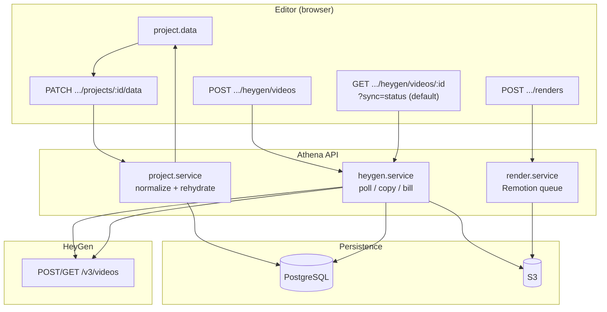
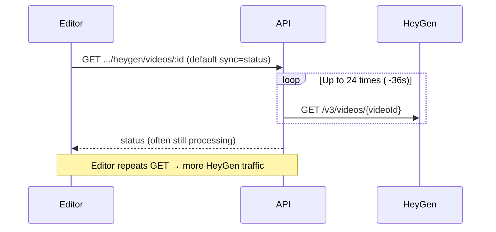
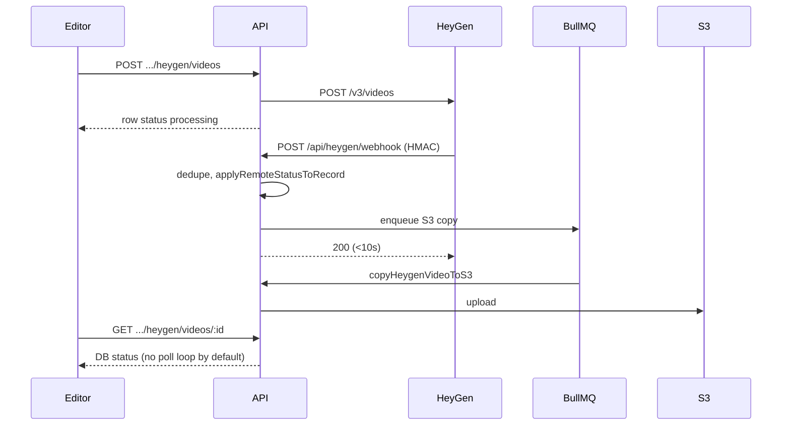

# Hybrid video editor & HeyGen webhook readiness — audit report

**Date:** 2026-11-21  
**Scope:** Scene-based video editor (`project.data`), project-scoped HeyGen avatar jobs, speech-only scenes, server Remotion export, and infrastructure needed to move from **polling** to **webhooks** and toward a **hybrid** (browser-or-server) final export.  
**Code changed in this audit:** none — read-only review of `src/`, `prisma/schema.prisma`, and existing docs.  
**Audience:** Backend, editor frontend, and DevOps owners of Phase 0 (webhooks + durable queues) before client-render spikes.

**Companion docs (read these for contracts and plan, not duplicated here):**

| Doc | Role |
|-----|------|
| [`CLIENT_RENDERING_RECOMMENDATIONS.md`](CLIENT_RENDERING_RECOMMENDATIONS.md) | Target hybrid architecture, webhook handler rules, BullMQ, Phase 0 checklist |
| [`PROJECT_EDITOR_INTEGRATION.md`](PROJECT_EDITOR_INTEGRATION.md) | Editor payload, save/load, HeyGen playback patterns |
| [`api/HEYGEN_PROJECT_VIDEOS_API.md`](api/HEYGEN_PROJECT_VIDEOS_API.md) | HTTP paths, sync modes, stream/download |
| [`api/HEYGEN_API.md`](api/HEYGEN_API.md) | User-scoped avatars/voices (not scene video jobs) |
| [`api/WORKSPACE_API.md`](api/WORKSPACE_API.md) | Projects, renders, nested routes |
| [`HEYGEN_API_V3_MIGRATION_ASSESSMENT.md`](HEYGEN_API_V3_MIGRATION_ASSESSMENT.md) | v3-only status, known gaps (webhooks) |

**Official HeyGen references:** [Webhooks](https://developers.heygen.com/docs/webhooks), [Webhook events](https://developers.heygen.com/docs/webhook-events).

---

## Executive summary

| Area | Readiness | Summary |
|------|-----------|---------|
| **Editor data model & persistence** | **High** | Stable `sceneId`, normalization, rehydration, and dual storage (JSON + `heygen_responses`) support hybrid export sharing `resolveProjectManifest`. |
| **HeyGen job lifecycle (create → play → bill)** | **Medium** | Create, idempotency, engine fallback, S3 copy, and billing hooks are solid; **status delivery and durability are weak** (in-request polling, in-memory S3 queue). |
| **Polling → webhooks** | **Low (not started)** | No webhook route, no `HEYGEN_WEBHOOK_SECRET`, no lookup by HeyGen `video_id`, no event dedupe table. Polling is baked into default `GET` paths. |
| **Server render (Remotion fallback)** | **Medium** | Works end-to-end but **single-process queue**, **double H.264 encode**, and **hard dependency on HeyGen in S3** limit scale and hybrid parity. |
| **Hybrid client export** | **Low (by design)** | Manifest resolution and timing utilities exist; no client manifest API, device gate, or BullMQ render workers yet. |

**Recommendation:** Ship **Phase 0** (webhooks + durable HeyGen S3 copy + BullMQ render workers) **before** investing in the full browser compositor. That alone removes the user-visible pain (HeyGen status loops, lost S3 copies, one-at-a-time exports) and unblocks hybrid work. Details in [§10 Implementation roadmap](#10-implementation-roadmap).

---

## 1. System architecture (as implemented)

### 1.1 Route and module map

```
/api/heygen/*                          → src/modules/heygen/     (catalog, voices, share)
/api/workspaces/.../projects/.../heygen → src/modules/video/     (scene avatar videos)
/api/workspaces/.../projects/.../speech → src/modules/speech/    (TTS audio scenes)
/api/workspaces/.../projects/.../renders → src/modules/render/    (Remotion export)
/api/workspaces/.../projects             → src/modules/project/   (editor JSON)
```

HeyGen HTTP client: `src/shared/services/heygenV3.client.js`  
Scene video orchestration: `src/modules/video/services/heygen.service.js`  
v3 API wrappers (create video, list looks, etc.): `src/modules/heygen/heygenV3.service.js`

### 1.2 Data flow (editor + HeyGen + export)



### 1.3 Separation of concerns (strengths)

| Concern | Where it lives | Notes |
|---------|----------------|-------|
| Editor JSON contract | `projectEditorNormalize.js` | V2 clips/timing/style → Remotion-ready manifest |
| HeyGen row ↔ scene linkage | `projectHeygenRehydrate.js` | Hash, sceneId, or best-row heuristics |
| HeyGen API quirks | `heygen.service.js` + `heygen` constants | Engine fallback IV/V/III |
| User asset ACL | `heygenAccess.service.js` + share DAOs | TEAM workspace sharing |
| Export compositing | `render/remotion/*` | Scene + project compositions |
| Credits | `creditLedger` + `creditPricing.js` | Afford at create; charge on S3 copy / render complete |

---

## 2. Video editor (`project.data`)

### 2.1 Schema contract

Documented in [`PROJECT_EDITOR_INTEGRATION.md`](PROJECT_EDITOR_INTEGRATION.md) §5. Implemented normalization in `src/modules/project/projectEditorNormalize.js`.

| Layer | Key fields | Server behavior |
|-------|------------|-----------------|
| Project | `videoSettings`, `scenes[]`, `meta` | Defaults merged from `DEFAULT_VIDEO_SETTINGS` / canvas presets on create |
| Scene | `sceneId`, `durationInFrames`, `background`, `elements[]` | `clips` alias → `elements` |
| HeyGen (scene) | `presenter`, `generation` | Merged with avatar element `content` via `getEffectiveHeygenFields()` |
| Avatar element | `type`/`role`/`provider`, `content.heygenVideoId` | `isHeygenAvatarElement()` |

**Rule for clients:** `heygenVideoId` in JSON is the backend UUID (`HeygenResponse.id`), **not** HeyGen’s `videoId` job id.

### 2.2 Save and load

| Operation | Path | Server steps |
|-----------|------|--------------|
| Save editor | `PATCH .../projects/:projectId/data` | `normalizeProjectState` → rehydrate HeyGen/speech → persist `duration`, cover thumbnail |
| Load project | `GET .../projects/:projectId` | Optional rehydrate + **write-back** if JSON fixed → `normalizeEditorProjectData` |

`preserveSceneAssignments` ensures TEAM scene assignees are not wiped by autosave.

### 2.3 Rehydration logic

File: `src/modules/project/projectHeygenRehydrate.js`.

Resolution order when `heygenVideoId` is missing or invalid:

1. Existing UUID if it exists in `heygen_responses` for this project  
2. `requestHash` from `presenter` + `content` fields (avatar, voice, script, engine)  
3. Best row for `sceneId` (`completed` + `s3Key` preferred)  
4. If scene has DB rows but no avatar element → inject `avatar_restored_*` element  

**Strength:** Projects reopened after long idle periods recover links without storing expiring CDN URLs in JSON.

**Findings:**

| ID | Finding | Severity | Location |
|----|---------|----------|----------|
| E1 | `tryResolveByRequestHash` does not pass `outputFormat` into `generateHeygenRequestHash` (defaults `mp4`) | Medium | `projectHeygenRehydrate.js` |
| E2 | GET project can mutate `project.data` when rehydration fixes IDs (read side effect) | Low | `project.service.js` `attachRehydratedProjectData` |
| E3 | Multiple jobs per scene: `pickBestHeygenRow` may not match user intent if they intended an older draft | Low | Product policy |

### 2.4 Editor features sharing the same stack

- **Video templates** (`videoTemplate.service.js`): `VIDEO_SCENE` / `VIDEO_PACK`; not the presentation deck template APIs.  
- **Speech-only scenes** (`speech.service.js`): parallel idempotency, S3, stream/download; rehydration in `projectSpeechRehydrate.js`.  
- **Storage quota** (`storageAccounting.service.js`): enforced on HeyGen S3 copy and final render upload.  
- **Project storage footprint** (`projectStorage.service.js`): recalculated after HeyGen copy and render.

### 2.5 Hybrid relevance

`render.service.js` → `resolveProjectManifest()` is the **canonical** server path to turn `project.data` into scene manifests with presigned asset URLs and HeyGen S3 keys. A hybrid client export should **reuse this function** (or a thin HTTP wrapper around it) so timeline, transitions (`buildSceneTimings` in `remotion/transitions`), and avatar resolution stay aligned with the server fallback.

---

## 3. HeyGen — project-scoped avatar videos

### 3.1 Create job

Entry: `POST /api/workspaces/:workspaceId/projects/:projectId/heygen/videos` → `generateAvatarVideo`.

| Step | Implementation |
|------|----------------|
| Workspace project check | `getProjectInWorkspace` |
| Engine resolution | `resolveVideoEngineForAvatar` → look metadata or legacy heuristics |
| Idempotency | `generateHeygenRequestHash` → unique `requestHash` |
| Credits afford | `creditLedger.assertCanAfford` (estimate from script length) |
| ACL | `heygenAccess.assertCanUseAvatarLook`, `assertCanUseVoice` |
| HeyGen call | `heygenV3.service.createVideo` → `POST /v3/videos` |
| Persist | `heygen.dao.saveHeygenResponse` (`billingStatus: pending`) |

Engine fallback on HeyGen 400: retry with alternate engine or Avatar III for legacy looks (separate hash / row).

### 3.2 Request hash (idempotency)

File: `src/shared/utils/requestHash.js`.

Inputs: `workspaceId`, `projectId`, `sceneId`, `avatarId`, `voiceId`, normalized script, `avatarEngine`, `outputFormat` (`mp4` \| `webm`).

**Important:** Create path includes `outputFormat`; rehydrate path often omits it (see E1).

### 3.3 Status sync and polling (current behavior)

Constants in `heygen.service.js`:

- `POLL_INTERVAL_MS = 1500`  
- `MAX_POLL_ATTEMPTS = 24` (~36 seconds max per invocation)

| API | Default sync | Behavior |
|-----|--------------|----------|
| `GET .../heygen/videos/:heygenVideoId` | `sync=status` | `pollLatestStatus` then `applyRemoteStatusToRecord`; may queue S3 copy |
| `GET .../download`, `GET .../stream` | implicit | `assertHeygenVideoPlayable` → may poll + sync |
| `GET .../s3-location` | `sync=full` | Blocks until S3 copy completes |

`parseHeygenVideoSyncMode`: `false` → `none`; `full` → full S3 sync in request; default → `status` (poll).

**Problem:** HeyGen generation often exceeds **minutes**. A 36-second in-request loop usually returns `processing`; the **editor polls again**, causing **cascading HeyGen `GET /v3/videos` traffic** and poor UX.

### 3.4 S3 ingest and playback

| Function | Role |
|----------|------|
| `applyRemoteStatusToRecord` | Maps remote status; on `completed`, sets `videoUrl` from HeyGen CDN |
| `copyHeygenVideoToS3` | Downloads full file → `uploadFileToKey` → `chargeHeygenVideoIfNeeded` |
| `queueHeygenVideoS3Upload` | In-memory `Map` keyed by `heygen_responses.id` |

Playback:

| Mode | Endpoint | Source |
|------|----------|--------|
| Stable API URL | `/stream` | S3 pipe or remote CDN via `streamRemoteUrlToResponse` |
| Presigned | `/download` | S3 presign or temporary HeyGen URL while copy pending |
| Export | `assertHeygenVideoReadyInS3` | **S3 only** |

Key pattern: `buildHeygenSceneVideoKey` in `videoStorageKeys.js` (workspace/folder/project/scene/heygen id + format).

### 3.5 Billing

| Event | Behavior |
|-------|----------|
| Create | Afford check only |
| S3 copy success | `chargeHeygenVideoIfNeeded` with idempotency `heygen-video:{row.id}` |
| Duration | Prefer `remote.duration`; else `estimateDurationFromScript` (webhook payloads may lack duration — already handled in recommendations doc) |
| Failed job | `billingStatus: failed` on HeyGen `failed` status |
| Refund on failure | **Not observed** in video module — product decision required |

### 3.6 Database model

`HeygenResponse` (`prisma/schema.prisma`):

- `id` — client-facing `heygenVideoId`  
- `videoId` — HeyGen job id (webhook correlator)  
- `status`, `s3Key`, `videoUrl`, `requestHash`, `billingContext`, etc.  

**Gap:** No DAO method `findHeygenResponseByVideoId` (HeyGen’s id). Required for webhooks.

### 3.7 User-scoped HeyGen (`/api/heygen`)

Separate from scene jobs. Large surface in `heygenV3.service.js` (avatars, voices, billing info). Workspace **share** routes allow TEAM members to use owner avatars/voices in project creates (`heygenAccess`).

v3 migration status: scene video is **v3-only** (`POST /v3/videos`). See [`HEYGEN_API_V3_MIGRATION_ASSESSMENT.md`](HEYGEN_API_V3_MIGRATION_ASSESSMENT.md).

---

## 4. Speech-only scenes (editor adjunct)

Path: `src/modules/speech/speech.service.js`.

Patterns mirror HeyGen videos: request hash, S3 key per scene, credits, stream/download. Rehydration: `projectSpeechRehydrate.js`. Render resolves via `getEffectiveSpeechFields` + `assertSpeechPlayable`.

**Note:** `getProjectInWorkspace` in **speech** selects `name` and `data`; the same helper in **heygen.service** does **not** (see H5 below). Speech billing context is more complete at create time.

---

## 5. Server render pipeline (Remotion export)

### 5.1 Flow

1. `startProjectRender` — afford `FEATURE.REMOTION_EXPORT`, create `ProjectRender` (`queued`), set project `status: rendering`.  
2. `renderQueue.enqueue` → `processProjectRender` (serial, in-process).  
3. `resolveProjectManifest` — all assets presigned (3600s); avatar elements require `assertHeygenVideoReadyInS3`.  
4. Per scene: Remotion `SceneComposition` → temp MP4 → optional `SceneRenderCache` in S3 (`sceneHash` + `SCENE_RENDER_COMPOSITOR_VERSION = 5`).  
5. `ProjectRenderComposition` stitches scene inputs → **second** H.264 encode → final S3 key → charge → inbox notification.

### 5.2 Queue and scaling

File: `src/modules/render/renderQueue.js`.

- One task at a time **per Node process**.  
- Comment: not shared across PM2 instances.  
- Contrast: presentation exports use **`exportQueue.js`** (BullMQ on Redis when configured).

### 5.3 Scene hash and cache

File: `src/modules/render/cache/sceneHash.js`.

Strips transient URLs from manifest before hashing. Cache is used **only** to feed the final stitch encode — **not** editor preview.

**Hybrid note:** Recommendations doc advises **not** maintaining scene cache for final export once client single-pass export exists unless another consumer appears.

### 5.4 Transparent / WebM avatars

`transparentVideo.js` + `SceneComposition.jsx`: `OffthreadVideo` with `transparent={isTransparentVideoSource(content)}`.

Server path supports alpha WebM via Remotion. Browser WebCodecs path has known alpha limitations (see [`CLIENT_RENDERING_RECOMMENDATIONS.md`](CLIENT_RENDERING_RECOMMENDATIONS.md) §1).

### 5.5 Render findings

| ID | Finding | Severity |
|----|---------|----------|
| R1 | In-process serial `renderQueue` | High |
| R2 | Double H.264 encode (per scene + final) | High (cost/latency) |
| R3 | Export requires HeyGen in S3 (not CDN-only) | Medium (correct but couples to S3 durability) |
| R4 | Failed render sets `project.status: failed` | Low (may conflate draft vs export failure) |
| R5 | Scene cache storage cost without editor consumer | Medium (hybrid cleanup candidate) |

---

## 6. Polling vs webhooks — gap analysis

### 6.1 Current state (polling)



### 6.2 Target state (webhooks + DB reads)



### 6.3 What already exists (reuse for webhooks)

| Building block | File / symbol |
|----------------|---------------|
| Status merge | `applyRemoteStatusToRecord` |
| S3 copy + bill | `copyHeygenVideoToS3`, `chargeHeygenVideoIfNeeded` |
| Client enrichment | `enrichHeygenVideoForClient` |
| v3 status fetch (sweeper / single GET) | `heygenV3.service.getVideoStatus` |

### 6.4 What is missing

| # | Item | Notes |
|---|------|-------|
| W1 | `POST /api/heygen/webhook` route | No JWT; HMAC on raw body ([`CLIENT_RENDERING_RECOMMENDATIONS.md`](CLIENT_RENDERING_RECOMMENDATIONS.md) §3) |
| W2 | `HEYGEN_WEBHOOK_SECRET` + per-env endpoint registration | `ENVIRONMENT.md` still says “no webhook env vars” |
| W3 | Raw body capture in `app.js` `express.json` verify hook | Re-serialized JSON breaks signature |
| W4 | `findHeygenResponseByVideoId` (+ index on `videoId`) | Correlate `avatar_video.*` events |
| W5 | Event dedupe persistence | `(event_type, video_id)` and `event_id` when present |
| W6 | BullMQ worker for S3 copy | Pattern: `src/modules/presentation/exportQueue.js` |
| W7 | Default `GET` behavior change | DB-only; optional `sync=refresh` single GET; remove `pollLatestStatus` from default path |
| W8 | Sweeper cron / job | Rows `processing` longer than expected generation window |
| W9 | API + editor doc update | Stop recommending tight poll loops in [`HEYGEN_PROJECT_VIDEOS_API.md`](api/HEYGEN_PROJECT_VIDEOS_API.md) |

### 6.5 Webhook handler rules (contract summary)

From recommendations doc — implement as acceptance criteria:

1. Verify HMAC-SHA256 of **raw** body with endpoint secret; constant-time compare.  
2. Respond **2xx within 10 seconds**; heavy work async.  
3. Idempotent status transitions; dedupe duplicate deliveries (24h retries).  
4. Do **not** reject events based on age (no signed timestamp in payload).  
5. On success: update row, enqueue durable S3 copy; on `completed` + existing `s3Key`, no-op.  
6. Unknown HeyGen `video_id`: log + **200** (avoid endless retries).  
7. Copy webhook `url` promptly (short-lived); fallback `GET /v3/videos/{id}`.  
8. Events: `avatar_video.success`, `avatar_video.fail` (v3 job ids).

---

## 7. Hybrid video editor readiness

### 7.1 Definition (this repo)

Per [`CLIENT_RENDERING_RECOMMENDATIONS.md`](CLIENT_RENDERING_RECOMMENDATIONS.md):

- **Hybrid:** Each export runs **entirely in browser** or **entirely on server** — not split across both.  
- **HeyGen** stays server-side.  
- **Browser** (if capable): manifest download, composite, encode, multipart upload.  
- **Server fallback:** existing Remotion path until client spike passes go/no-go.

### 7.2 Ready today

| Capability | Evidence |
|------------|----------|
| Normalized editor JSON | `projectEditorNormalize.js` |
| Manifest with presigned URLs | `resolveProjectManifest` |
| Scene timing / transitions | `buildSceneTimings`, `remotion/transitions` |
| HeyGen S3 keys in manifest | `resolveElementContent` + `assertHeygenVideoReadyInS3` |
| Credits for export | `FEATURE.REMOTION_EXPORT` |
| Stable preview without presigned expiry in JSON | `/stream`, rehydration |
| Reference BullMQ queue | `presentation/exportQueue.js` |

### 7.3 Not ready (expected)

| Capability | Blocker |
|------------|---------|
| Client export implementation | Spike on Remotion client renderer vs WebCodecs (recommendations §12) |
| Manifest HTTP for workers | No public route returning manifest + render lease |
| Device / codec gating | Not implemented |
| Durable HeyGen completion | Webhooks + queue (Phase 0) |
| Multi-worker render | BullMQ render worker |
| Single-pass encode | Requires client path or render refactor |
| Alpha parity in browser | Stacked-alpha ingest spike |

### 7.4 End-to-end dependency chain for hybrid

```
Phase 0: Webhooks + BullMQ (HeyGen S3 + render)
    → Editor reads DB status; reliable S3 for manifest
Phase 1: Manifest API + credit reservation for client upload
    → Browser can export with same inputs as Remotion
Phase 2: Renderer spike / alpha spike
    → Go/no-go for WebCodecs vs Remotion client
Phase 3: Production hybrid router (device benchmark + project probes)
```

---

## 8. Consolidated findings register

### 8.1 Critical / high

| ID | Area | Finding | Recommended action |
|----|------|---------|-------------------|
| H1 | HeyGen | No webhook; default GET polls HeyGen up to ~36s | Phase 0 webhook + change default GET to DB-only |
| H2 | HeyGen | `queueHeygenVideoS3Upload` in-memory; errors swallowed | BullMQ job; structured logging/alerting |
| H3 | Render | `renderQueue` single-process | BullMQ worker(s) on existing Redis |
| H4 | Render | Double H.264 encode | Defer single-pass until client path; or interim flag |
| H5 | HeyGen | `getProjectInWorkspace` omits `name`/`data` in `heygen.service` | Align select with `speech.service` |

### 8.2 Medium

| ID | Area | Finding | Recommended action |
|----|------|---------|-------------------|
| M1 | Editor | Rehydrate hash omits `outputFormat` | Pass format from `billingContext` or content |
| M2 | HeyGen | Full-file buffer download on S3 copy | Stream to S3 or size limits + monitoring |
| M3 | Billing | No automatic refund on `failed` after afford | Define product policy + ledger reversal |
| M4 | Ops | No `findByVideoId` / dedupe table | Prisma migration + DAO |
| M5 | Alpha | WebM in export vs client decode limits | Follow recommendations alpha spike |

### 8.3 Low

| ID | Area | Finding |
|----|------|---------|
| L1 | Editor | GET project write-back on rehydrate |
| L2 | Render | Project `status: failed` on render fail |
| L3 | Docs | `HEYGEN_V2_MIGRATION_IMPLEMENTATION_PLAN.md` still says “polling only” — supersede with Phase 0 |

---

## 9. Environment and operations checklist

### 9.1 Existing (required today)

| Variable | Purpose |
|----------|---------|
| `HEYGEN_API_KEY` | Create + status GET |
| `HEYGEN_BASE_URL` | Optional API host override |
| `AWS_S3_*` | HeyGen copy, stream, render output |
| Redis | App startup requires Redis (`app.js`) — reuse for BullMQ |

### 9.2 Add for webhooks (per environment)

| Variable / config | Purpose |
|-------------------|---------|
| `HEYGEN_WEBHOOK_SECRET` | HMAC verification (one secret per registered endpoint) |
| Public HTTPS API base | HeyGen `POST /v3/webhooks/endpoints` registration |
| Separate dev / staging / prod endpoints | Avoid shared secrets across environments |

Register example (from recommendations doc):

```bash
curl -X POST "https://api.heygen.com/v3/webhooks/endpoints" \
  -H "X-Api-Key: $HEYGEN_API_KEY" \
  -H "Content-Type: application/json" \
  -d '{
    "url": "https://<public-api-host>/api/heygen/webhook",
    "events": ["avatar_video.success", "avatar_video.fail"]
  }'
```

Store returned `secret` once as `HEYGEN_WEBHOOK_SECRET`. Local dev: tunnel (ngrok, etc.) or rely on single status GET + sweeper.

### 9.3 Observability (recommended)

| Signal | Why |
|--------|-----|
| Counter: webhook received / verified / rejected | Security + integration health |
| Histogram: S3 copy duration / bytes | Capacity planning |
| Gauge: BullMQ queue depth (HeyGen copy, render) | User-visible latency |
| Alert: `processing` rows older than N minutes | Sweeper / missed webhook |

---

## 10. Implementation roadmap

Aligned with [`CLIENT_RENDERING_RECOMMENDATIONS.md`](CLIENT_RENDERING_RECOMMENDATIONS.md) Phase 0 and this audit.

### Phase 0 — Webhooks and durable queues (prerequisite for hybrid UX)

**Goal:** Editor stops driving HeyGen status loops; S3 copies survive process restarts; exports can scale beyond one Node mutex.

| Step | Deliverable | Acceptance test |
|------|-------------|-----------------|
| 0.1 | Prisma: optional `HeygenWebhookEvent` dedupe; index on `HeygenResponse.videoId` | Duplicate webhook does not double-charge |
| 0.2 | `app.js` raw body verify for webhook route only | Invalid signature → 401/403; valid → 200 <10s |
| 0.3 | `heygen.webhook.controller` + route on `/api/heygen/webhook` | `avatar_video.success` updates row, enqueues copy |
| 0.4 | BullMQ queue `heygen-s3-copy` worker calling `copyHeygenVideoToS3` | Kill API mid-copy → job completes after restart |
| 0.5 | Change default `getProjectHeygenVideo` to DB-only; `sync=refresh` one GET | No `pollLatestStatus` on default GET |
| 0.6 | Sweeper job for stale `processing` | Stuck row recovers via GET + copy |
| 0.7 | Fix H5, M1 | Billing context shows project/scene names; webm hash rehydrate |
| 0.8 | Docs: `ENVIRONMENT.md`, `HEYGEN_PROJECT_VIDEOS_API.md`, Postman | Editor polls DB / inbox, not HeyGen via API loop |
| 0.9 | BullMQ `project-render` worker | Two concurrent exports on two workers |

**Exit criteria:** Staging project generates avatar video; editor sees completion without API polling HeyGen; MP4 in S3; render succeeds; restart during copy still completes.

### Phase 1 — Hybrid prerequisites (server API only)

- `POST .../renders/client-manifest` (or similar): returns `resolveProjectManifest` + upload policy.  
- Credit reserve + commit on multipart complete (mirror render billing).  
- Optional: inbox/SSE event when `heygenVideoId` becomes `playbackReady`.

### Phase 2 — Client renderer spikes

Per recommendations §12: Remotion client vs WebCodecs; alpha spike for transparent avatars.

### Phase 3 — Hybrid router in editor

Device benchmark cache, per-project codec/container probes, fallback to server render queue.

---

## 11. Test matrix (suggested)

| # | Scenario | Expected |
|---|----------|----------|
| 1 | Create HeyGen video idempotent same hash | 201 first; second returns same row |
| 2 | Webhook success before first GET | Row `completed`; copy enqueued; GET shows ready |
| 3 | Duplicate webhook delivery | Single S3 object; single charge |
| 4 | Webhook fail | `status: failed`, `billingStatus: failed` |
| 5 | Unknown `video_id` in webhook | 200, logged, no crash |
| 6 | GET default after Phase 0 | No outbound HeyGen call |
| 7 | `sync=full` on download | S3 required; 409 until copy done |
| 8 | Reopen project missing `heygenVideoId` | Rehydrate restores id |
| 9 | webm + mp4 same script | Distinct hashes; correct rehydrate after M1 fix |
| 10 | Export with processing avatar | 409 `PROJECT_SCENE_ASSET_NOT_READY` |
| 11 | Export with CDN-only completed | 409 until S3 copy |
| 12 | Two parallel renders (post BullMQ) | Both complete |

---

## 12. File reference index

| Topic | Primary files |
|-------|----------------|
| Scene HeyGen orchestration | `src/modules/video/services/heygen.service.js` |
| HeyGen HTTP client | `src/shared/services/heygenV3.client.js` |
| v3 create/status | `src/modules/heygen/heygenV3.service.js` |
| Project HeyGen routes | `src/modules/video/heygenVideo.routes.js`, `heygenVideo.controller.js` |
| Editor normalize | `src/modules/project/projectEditorNormalize.js` |
| HeyGen rehydrate | `src/modules/project/projectHeygenRehydrate.js` |
| Project save/load | `src/modules/project/project.service.js` |
| Render pipeline | `src/modules/render/render.service.js`, `renderQueue.js` |
| Remotion compositions | `src/modules/render/remotion/SceneComposition.jsx`, `ProjectRenderComposition.jsx` |
| BullMQ reference | `src/modules/presentation/exportQueue.js` |
| Request hash | `src/shared/utils/requestHash.js` |
| Schema | `prisma/schema.prisma` (`HeygenResponse`, `ProjectRender`, `SceneRenderCache`) |

---

## 13. Open product decisions

Record answers before implementation tickets close:

1. **Failed HeyGen job:** Refund afford / reverse charge, or charge only on success (current: charge on S3 success)?  
2. **Multiple HeyGen rows per scene:** Keep all for history or prune on new create?  
3. **Editor notifications:** Poll DB interval vs push (inbox/SSE) on completion?  
4. **Hybrid v1:** Webhooks + queue only, or include render BullMQ in same release train?  
5. **WebM alpha:** Required for hybrid MVP or MP4 cutout only until alpha spike passes?

---

## 14. Sign-off template

| Role | Phase 0 ready? | Notes | Date |
|------|----------------|-------|------|
| Backend lead | | | |
| Editor frontend lead | | | |
| DevOps | | | |
| Product | | | |

---

**Document history**

| Version | Date | Change |
|---------|------|--------|
| 1.0 | 2026-11-21 | Initial exhaustive audit for hybrid + webhook readiness |